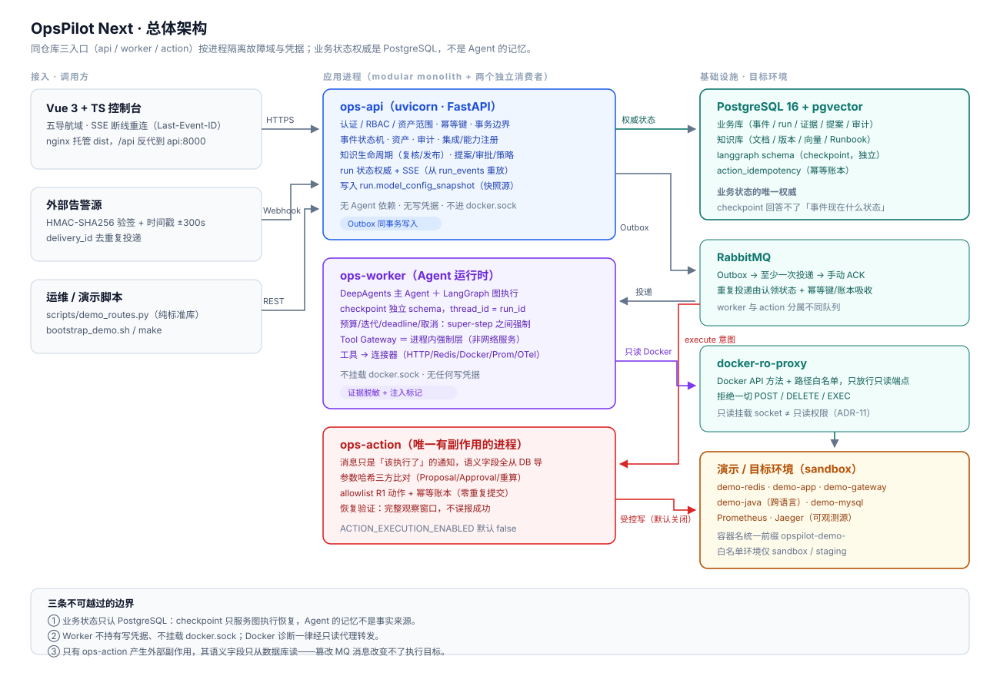
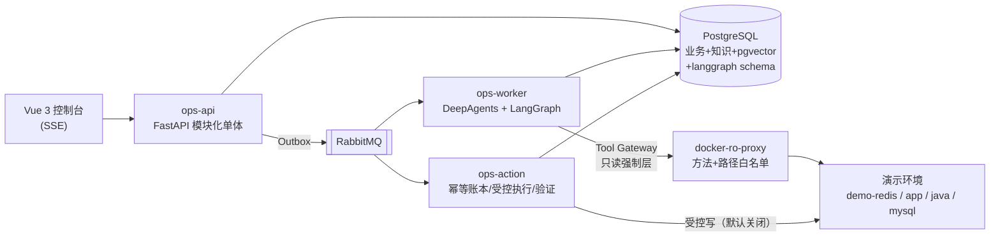

# OpsPilot Next

**一个把「AI 能不能自己动手修故障」这件事做对的工程实现**：Agent 负责诊断，
但动手之前必须过提案、四眼审批、只读前置检查、执行门禁四道闸；
每一句结论都必须挂到真实采集的证据上。

> 定位：可运行 / 可验证 / 可审计的**工程作品**，不是生产系统。
> 生产缺口逐条列在 [DEPLOYMENT_GUIDE.md](docs/DEPLOYMENT_GUIDE.md) §9，
> 安全能力的适用边界在 [SECURITY_ACCEPTANCE.md](docs/SECURITY_ACCEPTANCE.md) §12——
> 我们不把「应用层 allowlist」说成「基础设施隔离」。

---

## 现在能跑出什么

| | 结果 | 证据 |
| --- | --- | --- |
| 全量测试 | **347 passed / 3 skipped** | `uv run pytest`（真实 PostgreSQL，非 mock） |
| 确定性评估 | **39/39**（4 套件：fault-core 12 / security-gates 13 / rag-ablation 6 / reliability-recovery 8） | `docs/eval/fake_ci_report_judge_v2.json` |
| 真实模型评估 | **固定案例规则通过率 10/10**（`deepseek-chat` + 确定性 stub，judge-v2） | [EVALUATION_REPORT.md](docs/EVALUATION_REPORT.md) |
| 浏览器 E2E | **8/8**（Playwright 真实点击，24.6s） | `web/console/e2e` |
| 干净环境 | 克隆 → 首次诊断 **约 45 秒** | [DEMO_SCRIPT.md](docs/DEMO_SCRIPT.md) §6 |
| CI | GitHub Actions 全绿（lint / mypy / pytest / 39 例评估 / 前端构建 / 浏览器 E2E） | `.github/workflows/` |

**一个必须说清楚的口径**：`10/10` 是「**固定案例规则通过率**」，
样本 10 例、单模型、单次运行、基础设施是确定性 stub。
它**不是**泛化根因准确率。为什么不这么叫，写在 [EVALUATION_REPORT.md](docs/EVALUATION_REPORT.md) §0。

---

## 60 秒跑起来

前置：Docker（Windows 用 Docker Desktop + WSL2 后端）、可用内存 ≥ 6 GB。
**宿主机不需要 Python 或 Node**——种子脚本在容器里跑，前端在构建阶段编译。

```bash
git clone <repo> OpsPilot && cd OpsPilot
cp .env.example .env        # 至少改 JWT_SECRET / BOOTSTRAP_ADMIN_PASSWORD / WEBHOOK_ALERTS_SECRET

bash scripts/bootstrap_demo.sh --with-demo
# Windows PowerShell：powershell -ExecutionPolicy Bypass -File scripts/bootstrap_demo.ps1 -WithDemo
```

打印出的地址：

- 控制台 <http://localhost:8080>（Vue 3 + TS，五导航域）
- API 文档 <http://localhost:8000/docs>
- 演示账号：`e2e_admin` / `e2e_operator` / `e2e_approver` / `e2e_viewer`，密码统一 `E2ePassw0rd!2026`

然后三条演示路线选一条（每条 10 秒左右）：

```bash
python scripts/demo_routes.py a   # 故障登记 → Agent 诊断 → 证据 → 报告
python scripts/demo_routes.py b   # 历史知识 → RAG 检索 → 辅助诊断（需 RAG_MODE=hybrid）
python scripts/demo_routes.py c   # 提案 → 四眼审批 → 执行门禁 → 恢复验证
python scripts/demo_routes.py recover   # 撤销故障注入
```

每一步会看到什么、为什么是这个结果、怎么清理，全部写在
**[docs/DEMO_SCRIPT.md](docs/DEMO_SCRIPT.md)**。

默认 `AGENT_PROVIDER=fake`（零成本、确定性）。要接真实模型：

```bash
sed -i 's/^AGENT_PROVIDER=fake/AGENT_PROVIDER=deepseek/' .env
sed -i 's/^AGENT_MODEL_NAME=fake-diagnoser/AGENT_MODEL_NAME=deepseek-chat/' .env
sed -i 's/^AGENT_FAKE_PROVIDER_ENABLED=true/AGENT_FAKE_PROVIDER_ENABLED=false/' .env
echo 'DEEPSEEK_API_KEY=sk-...' >> .env
docker compose up -d api worker
```

**api 和 worker 必须同时重建**：run 的 `model_config_snapshot` 由 api 进程写入，
只重建 worker 会出现「报告是 deepseek、快照是 fake」的自相矛盾（真实踩过的坑）。

---

## 三条路线分别在证明什么

### A｜诊断有据可查

`docker stop` 一台真实 Redis → Agent 用只读工具采集 4–9 条证据 → 报告里每个假设
都带 `supporting_evidence_ids`；状态为 `unavailable` 的证据也带 `error_code`，
**「没看到异常」不会被当成「没有问题」**。

### B｜RAG 不是把文档塞进 prompt

知识有 draft/review/publish 生命周期、四眼复核、按资产范围前置过滤；
检索是全文 + pgvector 双路召回再做 RRF 融合，返回 `ranks.text / ranks.vector` 让你看得见
「哪一路捞回来的」。检索结果带 `untrusted text — leads only, never root cause evidence`，
知识**永远不进入**根因的支撑集。跨资产的历史经验只会成为排查方向。

### C｜Agent 不能自己动手

提案 → dry-run 七项只读检查 → 发起人自审被 `403 FORBIDDEN`（四眼）→ 另一人审批 →
执行。**默认配置下真实写操作在门禁处就被拒绝**（`ACTION_EXECUTION_ENABLED=false`），
终态 `execution_failed` + `result_detail.reason` 记录原因，外部效果确定为零，
`docker inspect --format '{{.RestartCount}}'` 可以自证 = 0。

想看 `verified` 全链路（真实重启 + 观察窗口 + 验证通过）：跑集成测试
`uv run pytest tests/integration/test_action_flow.py`，或在**独立演示 Daemon** 上
显式开启执行开关。宿主 `docker.sock` 不是隔离环境，这条线我们不放宽。

---

## 架构（30 秒版）





三条边界是这个架构的全部意义：

1. **业务状态权威 = PostgreSQL**。LangGraph checkpoint 只服务图执行恢复，
   thread_id = run_id，回答不了「这个事件现在是什么状态」。
2. **Worker 不持有任何写凭据**，也不挂载 `docker.sock`——只读挂载 socket 等于交出
   Daemon 控制权（ADR-11），所以 Docker 诊断一律经 `docker-ro-proxy` 转发。
3. **只有 ops-action 能产生外部副作用**，且它的执行语义字段**只从数据库读**，
   RabbitMQ 消息只是一句「该执行了」的通知（D6 防篡改，见安全验收 §1）。

完整职责边界、时序图、一致性模型：[docs/ARCHITECTURE.md](docs/ARCHITECTURE.md)。
三张图（总体架构 / 故障诊断时序 / 审批与执行时序）的 SVG 源在
[docs/diagrams/](docs/diagrams/)。为什么选 DeepAgents 而不是手写 ReAct：
`docs/ADR-D2-EXECUTION-CORE.md`。

---

## 技术栈

Python 3.12 · FastAPI · Pydantic v2 · SQLAlchemy 2 (async) · Alembic · PostgreSQL 16 + pgvector ·
**DeepAgents 0.7.32 / LangGraph 1.2.18 / LangChain 1.4.7** · RabbitMQ · Vue 3 + TypeScript + Vite ·
Docker Compose · uv / Ruff / mypy / pytest / Playwright

---

## 项目结构

```
OpsPilot-Next/
├── app/
│   ├── main.py                # 应用工厂 + lifespan（引擎/引导/嵌入预热）
│   ├── core/                  # 配置、DB Session、JWT+argon2、错误枚举、响应包裹、分页
│   ├── models/                # SQLAlchemy 2 模型（业务/诊断/注册中心/知识/处置/评估）
│   ├── domains/
│   │   ├── auth/ access/ assets/ incidents/ alerts/ audit/ idempotency/
│   │   ├── runs/              # run 生命周期、状态权威、SSE 事件
│   │   ├── tools/             # Tool Gateway + manifest + 连接器 + 脱敏/注入标记
│   │   ├── agent/             # AgentRuntime / Provider / Fake 模型 / 提示词
│   │   ├── integrations/      # 连接器实例与能力注册中心
│   │   ├── knowledge/         # 知识生命周期（四眼复核/发布/退役/报告转草稿）+ Runbook
│   │   ├── rag/               # Embedding Provider + 分块 + 混合检索（RRF）
│   │   ├── approvals/         # 提案/审批/策略/allowlist/dry-run
│   │   └── evaluations/       # 39 例数据集、judge-v1/v2、runner
│   ├── worker/                # DB 认领（SKIP LOCKED）+ 租约 + fence_token fencing
│   ├── action/                # ops-action：消费、防篡改复核、执行、验证、收敛
│   └── api/v1/                # 路由（49 路径 / 56 操作）
├── entrypoints/               # 单仓三入口：api / worker / action
├── roproxy/                   # docker-ro-proxy（Docker API 方法+路径白名单）
├── web/                       # 控制台镜像（多阶段：node 构建 → nginx 托管 + /api 反代）
│   └── console/               # Vue 3 + TS 源码（views / api / sse / components）+ Playwright e2e
├── demo/  demo-java/          # 演示故障环境（FastAPI 样例、网关、Java Spring Boot、Prometheus）
├── scripts/                   # bootstrap / seed / demo_routes / eval_* / rag_experiment
├── alembic/                   # 迁移（0001 初始 → 后续各阶段，禁用 create_all）
├── docs/                      # 设计文档 + 交付文档（见下）
└── docker-compose.yml         # 13 容器；demo / demo-fault profile 分离
```

---

## 文档

| 想干什么 | 看这个 |
| --- | --- |
| 跑起来 / 排障 / 生产缺口 | [DEPLOYMENT_GUIDE.md](docs/DEPLOYMENT_GUIDE.md) |
| 想自己点一遍（三条流程） | [TRY_IT.md](docs/TRY_IT.md)（含「预期内的失败」对照表） |
| 三条演示路线怎么走、看到什么 | [DEMO_SCRIPT.md](docs/DEMO_SCRIPT.md) |
| 调接口 | [API_REFERENCE.md](docs/API_REFERENCE.md)（或 `/docs`） |
| 理解设计取舍 | [ARCHITECTURE.md](docs/ARCHITECTURE.md) · [ADR-D2](docs/ADR-D2-EXECUTION-CORE.md) |
| 评估数据与口径 | [EVALUATION_REPORT.md](docs/EVALUATION_REPORT.md) |
| 安全边界与门禁证据 | [SECURITY_ACCEPTANCE.md](docs/SECURITY_ACCEPTANCE.md) |
| 踩过哪些坑、怎么定位的 | [FAILURE_POSTMORTEMS.md](docs/FAILURE_POSTMORTEMS.md) |
| 看界面长什么样 | [docs/screenshots/](docs/screenshots/)（真实栈采集，含证据链与审批门禁） |
| 准备面试 / 答辩 | [interview_notes.md](docs/interview_notes.md)（25 个追问，全部锚到源码） |
| 这一版交付了什么、边界在哪 | [RELEASE_NOTES.md](docs/RELEASE_NOTES.md) · [D7-DELIVERY.md](docs/D7-DELIVERY.md) |
| 设计阶段冻结契约 | [PRD.md](docs/PRD.md) · [CONTRACTS.md](docs/CONTRACTS.md) · [DATA_MODEL.md](docs/DATA_MODEL.md) · [IMPLEMENTATION_PLAN.md](docs/IMPLEMENTATION_PLAN.md) |

---

## 测试与评估

```bash
make test          # 全量（约 4 分钟，需先 docker compose up -d postgres）
make eval-39       # 39 例确定性评估
make e2e           # Playwright 8 例
make lint typecheck
```

测试用真实 PostgreSQL：pytest 自动建 `opspilot_test` 库并跑迁移，不起 mock 数据库。
`tests/conftest.py` 把 `AGENT_PROVIDER=fake` / `RAG_MODE=off` 钉死，
防止开发者本地 `.env`（演示用 deepseek/hybrid）污染测试基线——这条是踩过坑才加的。

真实模型评估需要 Key，且脚本有库名白名单 + `--confirm` 双闸：

```bash
uv run python scripts/eval_real_model.py --confirm --out docs/eval
```

---

## 本地开发（不用 Docker 跑 API）

```bash
docker compose up -d postgres     # 只起数据库
uv sync                           # 国内网络建议配 UV_DEFAULT_INDEX 镜像
uv run alembic upgrade head
uv run uvicorn app.main:app --reload --port 8000
```

前端开发：`cd web/console && npm ci && npm run dev`（Vite dev server 代理 `/api` 到 8000）。

---

## 已知边界（诚实清单）

1. **不是生产系统**：无 TLS、无语钥管理、单实例数据库、审计表可写不可验（无 WORM/哈希链）。
2. **真实写操作默认关闭**，且宿主 socket 不是隔离环境——这是**有意保留**的安全默认值。
3. **评估口径有限**：10 例固定案例、单模型、单次运行，基础设施是 stub，不能外推为泛化能力。
4. **Prompt Injection 是模式匹配 + 上下文隔离**，不是语义级防御；兜底靠「写操作必须过人审」。
5. **SSE 只是加速通道**，`GET /runs/{id}` 才是状态权威；前端断线重连靠 `Last-Event-ID` 重放。
6. **无多租户**：单一组织，`asset_access_policies` 做的是用户/角色级资产范围。

这些不是待办事项的托词——每一条都在对应文档里写清了「现在是什么、缺什么、为什么先不做」。
