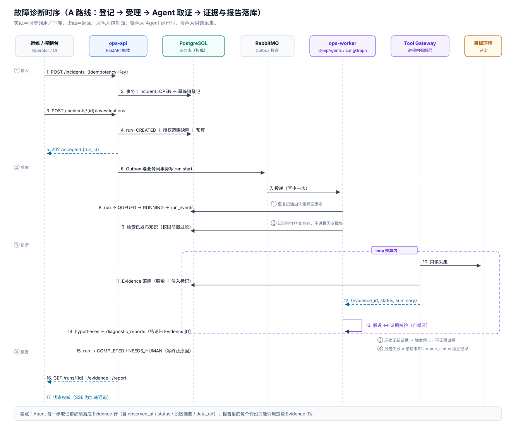
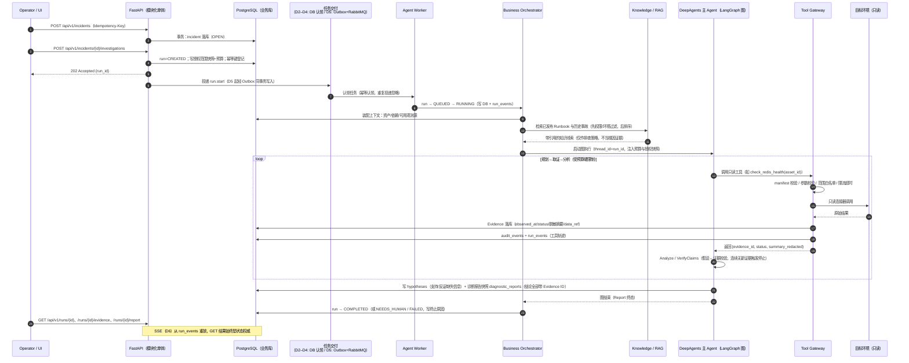
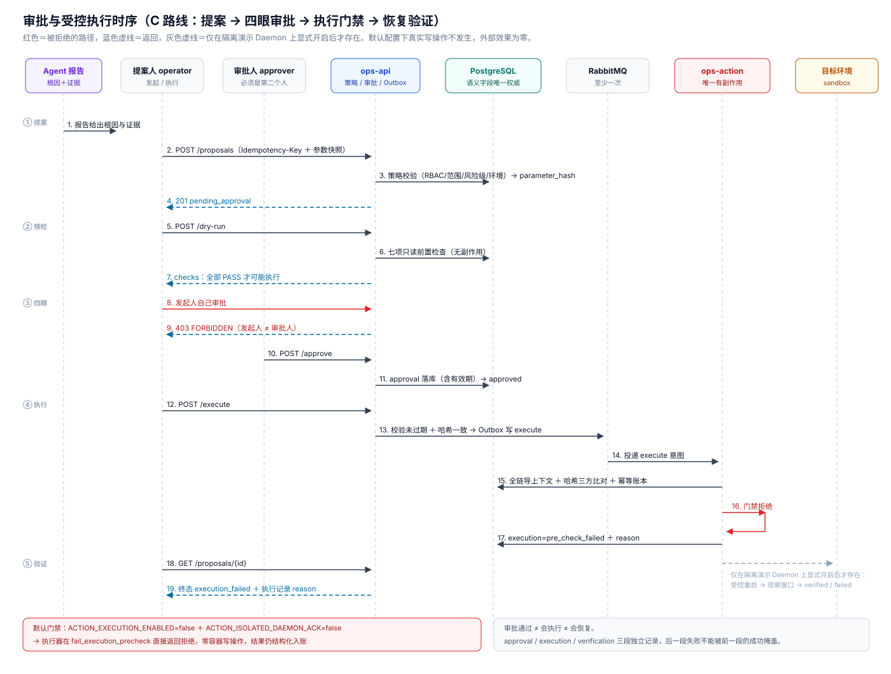
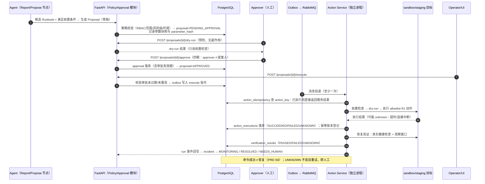

# OpsPilot Next｜架构设计（D0 冻结稿）

**版本**：v1.1（D0 架构与契约冻结；v1.1 为架构评审定向修订——Docker 只读代理、诊断报告快照、幂等保证等级、Worker fencing、D1 默认决策确认）
**日期**：2026-10-27
**需求基线**：`docs/PRD.md` v1.1（唯一需求来源，本文不扩充 PRD 之外的功能）
**性质**：设计约束文档。本文描述的是"将要构建的系统必须遵守的结构"，不是已实现成果。

---

## 1. 文档定位

本文回答四个问题：

1. 系统由哪几个部署单元组成，为什么这样切分；
2. 每个组件（FastAPI / 业务编排层 / DeepAgents / LangGraph / Tool Gateway / Action Service）负责什么、**明确不负责什么**；
3. 数据存在哪里、谁有权读写哪一类数据；
4. 一次故障从提交到报告、再到受控处置的完整调用路径。

配套文档：

| 文档 | 内容 |
|---|---|
| `docs/PRD.md` | 需求基线（v1.1） |
| `docs/CONTRACTS.md` | REST API、实体、Evidence / Capability Manifest 契约 |
| `docs/DATA_MODEL.md` | 数据库表、约束、分阶段建表 |
| `docs/IMPLEMENTATION_PLAN.md` | D1–D7 阶段任务与验收 |

---

## 2. 总体架构

### 2.1 架构原则（来自 PRD §7，硬约束）

- **模块化单体 + 独立 Agent Worker**：业务功能以模块化单体交付（一个 FastAPI 应用内按领域分模块），Agent 执行是独立进程（Worker），有副作用执行是独立进程（Action Service）。首版不做微服务拆分。
- **三层边界**：AI 只出诊断建议；Tool Gateway 只管只读取证；Action Service 只管批准后的有副作用操作。**大模型输出不是授权凭据**。
- **业务状态以数据库为权威**：LangGraph checkpoint 只服务图执行的持久化与恢复，不是业务事实来源。
- **异步可靠交付**：长任务经队列投递给 Worker（D2 先用 PostgreSQL 任务认领过渡，D5 引入 RabbitMQ + Outbox）；至少一次投递，副作用靠幂等账本保证不重复。
- **不引入 PRD 未要求的组件**：首版不出现 Milvus、Kafka、Redis（系统自身用）、K8s Operator、多级缓存等。

### 2.2 架构图


> 图源：[diagrams/architecture.svg](diagrams/architecture.svg)（SVG，可离线查看）。
> 下面同时保留 Mermaid 版本，便于在 GitHub/IDE 内直接渲染与 diff。

```mermaid
flowchart TB
    subgraph Client["客户端"]
        UI["Vue 3 + TypeScript + Element Plus<br/>(按需 ECharts, SSE 消费)"]
    end

    subgraph Monolith["模块化单体 ops-api（一个 FastAPI 进程）"]
        FA["FastAPI REST + SSE 层<br/>鉴权 / 校验 / OpenAPI"]
        subgraph Mods["领域模块（服务层内聚，模块间经服务接口调用）"]
            AUTH["Auth / RBAC"]
            AIC["Asset / Incident / Alert"]
            ORCH["Business Orchestrator<br/>run 生命周期 / 预算 / 调度"]
            KND["Knowledge / RAG"]
            APP["Proposal / Policy / Approval"]
            EVL["Evaluation"]
            AUD["Audit"]
        end
        OUT["Outbox 表（D5 启用）"]
    end

    subgraph Worker["Agent Worker（独立进程 ops-worker）"]
        LR["LangGraph Runtime<br/>PostgresSaver（独立 schema）"]
        DA["DeepAgents 主 Agent<br/>规划 / 取证 / 分析 / 报告"]
        subgraph TG["Tool Gateway（进程内强制调用层）"]
            REG["Capability Registry 读取"]
            CH["参数校验 / 资产范围校验<br/>超时 / 限流 / 审计 / 脱敏"]
            CN["只读 Connectors<br/>HTTP / Docker / Redis / Prometheus..."]
        end
    end

    subgraph InfraProxy["只读基础设施代理"]
        DP["docker-ro-proxy<br/>方法+路径白名单（仅容器只读端点）"]
    end

    subgraph ActionSvc["Action Service（独立进程 ops-action，D5 起）"]
        IDEM["幂等账本 action_idempotency"]
        PRE["前置检查 / dry-run"]
        EX["allowlist R1 动作执行"]
        VRF["恢复验证（观察窗口）"]
    end

    PG[("PostgreSQL<br/>业务库 + 知识库 + pgvector<br/>+ langgraph 独立 schema")]
    MQ[["RabbitMQ（D5 起）/ DB 任务认领（D2–D4 过渡）"]]
    ENV["隔离演示环境 sandbox / staging<br/>(Docker Compose 可注入故障)"]

    UI -->|HTTPS| FA
    FA --> Mods
    ORCH --> OUT
    Monolith <--> PG
    OUT --> MQ
    MQ <--> Worker
    Worker <--> PG
    MQ <--> ActionSvc
    ActionSvc <--> PG
    CN -->|HTTP/Redis 只读| ENV
    CN -->|白名单只读 API| DP
    DP -->|受限 Docker API| ENV
    EX -->|受控写(仅隔离环境)| ENV
    KND -->|检索| PG
```

要点：

- **ops-api、ops-worker、ops-action 是同一个代码仓库里的三个入口**（`api` / `worker` / `action`），共享领域模型与服务层，按进程隔离故障域与凭据。
- Tool Gateway 是 **Worker 进程内的强制调用层（库），不是独立网络服务**：所有暴露给 Agent 的工具句柄只能由 Tool Gateway 生成，Agent 代码无法绕过。是否升级为独立服务是 D6 后的性能/合规议题，不在首版范围。
- Action Service 从 D5 起作为独立进程存在，**只有它持有 R1 动作所需凭据**；API 与 Worker 进程不持有任何有副作用的凭据。
- **Docker 只读代理（docker-ro-proxy，ADR-11）**：只读挂载 docker.sock **不能**保证 Docker API 只读——socket 持有者等于获得 Docker Daemon 完全控制权（可创建特权容器、挂载宿主文件系统）。因此 Worker 不直接接触 docker.sock，Docker 诊断请求一律经独立代理容器转发；代理按"HTTP 方法 + 路径白名单"只放行容器检查、日志、事件等只读端点，拒绝一切 POST/DELETE/EXEC。

### 2.3 部署视图（Docker Compose）

| 容器 | 进程 | 何时引入 | 说明 |
|---|---|---|---|
| `ops-api` | uvicorn (FastAPI) | D1 | REST + SSE；无 Agent 依赖 |
| `ops-worker` | worker 入口 | D2 | DeepAgents/LangGraph 运行时；**不挂载 docker.sock** |
| `docker-ro-proxy` | Docker 只读 API 代理 | D2 | 方法+路径白名单，仅放行容器只读端点（ADR-11） |
| `ops-action` | action 入口 | D5 | 有副作用执行 + 幂等账本 |
| `postgres` | PostgreSQL 16 + pgvector | D1 | 业务/知识/checkpoint |
| `rabbitmq` | RabbitMQ | D5 | 任务交付（此前用 DB 认领过渡） |
| 演示目标环境 | 样例应用 + Redis + 可注入故障 | D2 | Python FastAPI 样例；D3 加 Java Spring Boot |
| `web` | Vue 3 静态资源 + Nginx | D1（极简）/ D6（完整） | D1 只需最小页面验证闭环 |

---

## 3. 职责边界

### 3.1 FastAPI 应用层（含各领域模块）

**负责**：HTTP 协议、认证与 RBAC 首道校验、请求校验（Pydantic）、幂等键受理、事务边界、Outbox 写入、`202` 异步受理、SSE 事件流（读取 run_events 重放）、OpenAPI 导出。

**不负责**：Agent 规划与取证、直接调用任何目标环境、决定根因、生成 Proposal 内容、执行任何有副作用动作。

### 3.2 Business Orchestrator（业务编排层，运行于 api 与 worker 两进程内）

**负责**：InvestigationRun 生命周期与状态机推进；创建 Run 时的授权范围快照、预算（工具调用次数 / 迭代 / token / 时限）设定与**服务端硬限制执行**；调用 Knowledge 检索并把结果作为上下文注入 Agent；把 LangGraph 图结束事件翻译为业务终态（COMPLETED / NEEDS_HUMAN / FAILED 等）；取消协调（合作式取消标志）；把 Proposal 需求交给审批模块。

**不负责**：图内部节点如何推进（那是 LangGraph 的事）、工具如何连到目标环境（那是 Tool Gateway 的事）、审批策略细则的判断（那是 Policy/Approval 模块的事）。

### 3.3 DeepAgents（Agent 能力层，运行于 Worker）

**负责**：规划（planning todo）、工具使用循环、上下文管理（把大证据放到文件/状态外、摘要进上下文）、subagent 机制（首版默认单主 Agent，PRD §9）、产出结构化假设与报告（每条关键结论必须携带 Evidence ID）、证据不足时输出"待确认/未知"退出。

**不负责**：业务状态（run 状态是 DB 的）、授权决策、预算判断的最终裁决（预算由 Orchestrator 服务端硬限制，Agent 层只是遵守）、任何直接执行能力。

### 3.4 LangGraph（图执行与持久化层）

**负责**：显式业务流程图 `Validate → LoadAssets → RetrieveKnowledge → Plan → CollectEvidence → Analyze → VerifyClaims → {CollectMore | Report | Propose} → PolicyGate → Approval → Execute → VerifyRecovery → Finalize`（PRD §9）的节点编排；checkpoint 持久化（PostgresSaver，独立 schema）；中断/恢复（HITL 与故障恢复的执行态载体）；`thread_id = run_id` 的映射。

**不负责**：审批结论（HITL 中断只是暂停执行，企业审批由 Approval 模块完成，PRD §9 明确"LangGraph HITL 不能替代独立审批服务"）；业务事件（run_events 由业务代码写，不把 checkpoint 当事件表，PRD §11）；多线程并发安全之外的事务（业务事务由服务层管理）。

### 3.5 Tool Gateway（Worker 进程内强制层）

**负责**：工具注册与 Capability Manifest 校验；参数 Schema 校验；目标资产/环境白名单校验（防止 Agent 诊断 A 服务却去调 B 服务）；超时、速率、结果大小上限；SSRF / 命令注入 / 路径遍历防护；连接器调用（**Docker 连接器强制经 docker-ro-proxy 只读代理，Worker 无 docker.sock 访问权**）；结果归一化为统一 Evidence 并落库；脱敏与长度截断；工具调用审计（audit_events + run_events）；对外部返回内容按不可信文本处理（Prompt Injection 防线之一）。

**不负责**：写操作（任何写凭据不进入 Worker 进程）；知识检索（RAG 是 Orchestrator 提供的工具，走 Knowledge 模块）；授权策略（范围校验依据的是 Orchestrator 注入的授权快照）。

**红线**：模型永远拿不到通用 Shell、通用 SQL 执行器（PRD §10）。工具返回给 Agent 的是 `{evidence_id, status, summary_redacted, 关键字段}`，原始大数据不进 Prompt。

### 3.6 Action Service（独立进程，D5 起）

**负责**：受理已审批 Proposal 的执行请求；幂等账本检查（action_key，防重复副作用，PRD §8）；执行前服务端复核（审批有效性、参数哈希、目标环境 ∈ {sandbox, staging}、Runbook 版本）；前置检查与 dry-run；执行 allowlist 内 R1 动作；恢复验证（真实健康检查 + 观察窗口，输出 PASSED / FAILED / UNKNOWN）；执行结果与验证结果落库；动作审计。

**不负责**：审批决策（只验证审批凭据与快照）；修改 Proposal 内容；生产环境任何写操作（首版硬性只读）；执行 allowlist 之外的动作（R3 类永久禁止）。

### 3.7 边界总表

| 关注点 | API 层 | Orchestrator | DeepAgents | LangGraph | Tool Gateway | Action Service |
|---|---|---|---|---|---|---|
| run 状态机 | — | **拥有（写 DB）** | — | — | — | — |
| 预算硬限制 | 受理时创建 | **拥有并强制** | 遵守 | 遵守 | 工具计数配合 | — |
| 证据采集 | — | — | 发起调用 | 节点编排 | **拥有（执行+落库）** | — |
| 证据/结论引用 | 查询返回 | — | **生成（带 Evidence ID）** | — | 归一化 | — |
| 授权决策 | RBAC 首道 | 快照+复核 | 无 | 无 | 范围校验 | 凭据+快照复核 |
| 有副作用执行 | 受理入口 | — | 只能"建议" | 流程占位 | 禁止 | **唯一执行者** |
| 恢复验证 | 查询返回 | 触发 | — | 流程占位 | — | **拥有** |
| 持久化恢复 | — | 触发恢复 | — | **拥有（checkpoint）** | — | 幂等账本兜底 |
| Prompt Injection 防线 | 输入校验 | — | 不信任外部文本 | — | **脱敏/截断/不可信标记** | — |

---

## 4. 存储边界

PostgreSQL 是唯一首版存储（PRD §7），内部按 schema / 表族隔离：

| 数据类别 | 位置 | 写入者 | 说明 |
|---|---|---|---|
| 业务库（用户/资产/事件/Run/诊断报告/知识/审批/审计/评估） | `public` schema（业务表族） | api / worker / action 服务层代码 | 唯一业务事实来源；迁移由 Alembic 管理 |
| LangGraph checkpoint | `langgraph` 独立 schema（checkpointer 库自管表） | LangGraph PostgresSaver | 保留 `thread_id` / `checkpoint_id`；**不当业务事件表用**（PRD §11）；业务代码只读写 `thread_id = run_id` 映射，不手工解析 checkpoint 内容 |
| RAG 向量数据 | `knowledge_embeddings`（pgvector） | D4 索引构建任务 | embedding 模型与版本随行入库（PRD §6） |
| Evidence 载荷 | `evidence` 单表（元数据 + `data_ref` JSONB 内联截断载荷或对象键引用；**不设独立 payload 表**） | Tool Gateway | 超限截断并标记 `truncated`；不上对象存储（首版规模不需要） |
| 幂等 | `api_idempotency_keys`（API 层）+ `action_idempotency`（执行层）+ 告警 `delivery_id` 唯一约束 | 各自模块 | 至少一次投递 → 业务幂等兜底 |
| 审计 | `audit_events` + 独立审批日志字段 | api / worker / action | **Agent 代码不持有写入审计表的凭据路径**；审批日志不可被 Agent 改写（PRD §8） |

保留与清理（PRD §8）：checkpoint 随 run 终态保留 N 天后归档删除（配置项）；Evidence/知识有归档与删除路径；不同资产/环境的知识不可越权召回（检索先过滤后排序）。

---

## 5. 核心调用流程

### 5.1 诊断主线（API 提交 → Agent 诊断 → 证据入库 → 报告）



> 图源：[diagrams/sequence-diagnosis.svg](diagrams/sequence-diagnosis.svg)。
> 实测运行记录见 [DEMO_SCRIPT.md](DEMO_SCRIPT.md) 路线 A。



文字步骤对照 PRD §3：第 1–2 步对应"接入/准备"，第 3 步"知识召回"，第 4–5 步"规划与取证/分析"，第 6 步"提案"在 D5 后由 `Propose` 节点触发（见 5.2），第 9 步"复盘/沉淀"是人工把报告提交为知识草稿（D4），不自动自我强化。

### 5.2 受控处置线（Proposal → 审批 → Action → 验证，D5 起）



> 图源：[diagrams/sequence-approval.svg](diagrams/sequence-approval.svg)。
> 默认配置下第 16 步「门禁拒绝」就是终点；`verified` 全链路见
> [SECURITY_ACCEPTANCE.md](SECURITY_ACCEPTANCE.md) 与 `tests/integration/test_action_flow.py`。



### 5.3 一致性模型

- **业务状态权威 = PostgreSQL**。前端展示、SSE、Agent 输出都不改变这一事实。
- **任务交付 = 至少一次**。D2–D4 用 `investigation_runs` 行级认领（`FOR UPDATE SKIP LOCKED` + 租约 + `lease_owner`/`fence_token`，回写校验 token 防旧 Worker 复活后并发写脏数据，ADR-12），D5 起 Outbox（同事务写业务状态与事件）→ RabbitMQ → Worker 手动 ACK；重复投递由认领状态与幂等键吸收。
- **副作用保证等级（分级承诺，不夸大）**：默认保证 = **零重复提交**（幂等账本 + `action_key` 防重）+ **结果未知不盲目重试**（标记 `unknown` 转人工，PRD §8）。"恰好一次外部效果"仅当 allowlist 中该动作的外部接口**明确支持幂等执行与状态查询**时才可声明（注册时标注 `idempotent: true`）。崩溃恢复依据账本状态与外部执行证据收敛：`claimed` 但无外部证据 → 判定 `unknown`，不重试（PRD §8、S10）。
- **审批后未知结果**：标记 UNKNOWN 并停止自动重试，转 NEEDS_HUMAN。

---

## 6. 安全边界总览

| 防线 | 机制 | 落点 |
|---|---|---|
| 身份与权限 | JWT（短期 access token）+ RBAC + 资产/环境范围 | API 层首道校验；Orchestrator 快照；Action 复核 |
| 只读防线 | 连接器仅实现只读 capability；Worker 进程无写凭据、**不接触 docker.sock**，Docker API 经 docker-ro-proxy 方法+路径白名单访问 | Tool Gateway + docker-ro-proxy |
| 写操作防线 | allowlist + R1 动作白名单 + 四眼 + 审批有效期 + 参数哈希复核 + 仅 sandbox/staging | Action Service |
| Prompt Injection | 外部文本（日志/网页/Runbook/工具输出）一律不可信、脱敏、截断、标记来源；不解析执行指令 | Tool Gateway / Knowledge |
| SSRF/注入 | 目标白名单（已登记资产）、协议限制、超时/大小上限、参数 Schema 校验 | Tool Gateway |
| 幂等与重试 | Idempotency-Key（API）、action_key（执行）、delivery_id（告警） | 各模块 |
| 审计 | audit_events 全覆盖关键动作；审批日志独立且不可被 Agent 改写 | API / Worker / Action |
| 密钥治理 | secret_refs 只存引用，凭据仅服务端解引用；不入 Prompt/trace/错误响应 | 全局 |
| 模型合规 | 模型经配置切换、版本锁定、成本计量；支持替换为合规模型 | 配置层 |

---

## 7. D1–D7 组件引入路线

| 关卡 | 新引入组件/依赖 | 架构含义 | 不允许提前引入 |
|---|---|---|---|
| D1 基础骨架 | FastAPI、SQLAlchemy 2、Alembic、PostgreSQL、JWT、pytest、Docker Compose、Vue3 最小页面 | 单体三入口中的 `api` 入口成型；`api_idempotency_keys`、`audit_events`、`outbox_events`（先建表不启用）就位 | RabbitMQ、DeepAgents、pgvector、任何连接器 |
| D2 诊断纵切 | `ops-worker` 入口、deepagents、langgraph、langchain、PostgresSaver（langgraph schema）、Tool Gateway 框架、HTTP/Docker/Redis 只读连接器（Docker 经只读代理）、诊断报告快照表、演示故障环境 | Worker 与 API 分进程；LangGraph checkpoint schema 创建；Evidence 管道贯通 | 有副作用工具、MySQL/Prometheus 连接器、RabbitMQ |
| D3 扩展接入 | Capability Manifest 注册表全套、Prometheus/日志后端只读接入、Java Spring Boot 样例、OTel/Prometheus 客户端观测 | 连接器从"硬编码工具"升级为"Manifest 声明式能力"；`query_metrics`/`query_traces` 入场 | 网页上传即执行的插件机制、MCP |
| D4 经验复用 | pgvector 扩展、embedding 客户端（可配置）、知识生命周期（draft→reviewed→published）、混合检索 | 知识数据族启用；RAG 开关对照成为评测的一部分 | 独立向量库（Milvus）、复杂文档解析平台、知识自动改写发布 |
| D5 审批与可靠性 | `ops-action` 入口、RabbitMQ、Outbox 启用、幂等账本、Runbook/Proposal/审批/验证全套 | 三进程架构完整；DB 认领过渡方案退役为降级路径 | 生产环境写操作、R2/R3 级动作 |
| D6 产品与质量 | Vue3 完整控制台、SSE、评估框架（≥30 场景）、成本/延迟计量、审计完善 | 全 UI 闭环；eval 数据族启用 | 新后端组件 |
| D7 作品交付 | 复现脚本、README、演示视频、面试素材 | 无新组件；只做交付物 | — |

依赖关系：D2 依赖 D1 的资产/事件/鉴权与 `outbox_events` 表位；D3 依赖 D2 的 Tool Gateway 框架；D4 依赖 D2 的 Evidence 管道（历史事故来自 Run 报告）；D5 依赖 D1 的事务基础与 D2 的 Worker；D6 依赖 D2–D5 全部数据族；D7 依赖全部。

---

## 8. 关键架构决策记录（ADR 摘要）

| # | 决策 | 理由 | 代价/回退 |
|---|---|---|---|
| ADR-1 | 模块化单体（api/worker/action 三入口一仓库），不拆微服务 | PRD §7 选型；团队规模与迭代速度；模块边界用包结构与依赖规则约束 | 未来拆分需理清服务层接口，成本可控 |
| ADR-2 | Tool Gateway 为 Worker 进程内强制库而非独立服务 | 减少一跳网络与一个部署单元；强制力靠"工具句柄仅由 Gateway 生成"保证 | 若未来多语言连接器增多，可独立成服务（预留接口边界） |
| ADR-3 | Action Service 独立进程、独立凭据 | 满足"Agent Runtime 不拥有生产写凭据"（PRD §7）；爆炸半径隔离 | 多一个部署单元，D5 前无此进程 |
| ADR-4 | D2–D4 用 PostgreSQL 行级认领做任务交付，D5 切 RabbitMQ + Outbox | RabbitMQ 是 D5 关卡内容；DB 认领简单可靠，避免 D2 就背负消息运维 | D5 需要一次性切换交付通道（封装 Delivery 接口隔离差异） |
| ADR-5 | D2 即使用 PostgresSaver 持久 checkpoint（独立 schema），不经过 MemorySaver | PostgreSQL 已在位；避免 D5 更换 checkpointer 造成的迁移成本（PRD §18 要求生产用持久化 saver） | D2 多一张 schema 的运维认知成本 |
| ADR-6 | 环境建模为受控枚举（sandbox/staging/production）+ 资产字段与策略维度，首版不建独立 environments 实体 | PRD §1/§8 只定义三类环境；避免第一天过度建模 | 若需要多环境实例，新增参考表属于向后兼容迁移 |
| ADR-7 | 工具返回给 LLM 的是 Evidence 引用+脱敏摘要，原始载荷落库 | 控制上下文体积（DeepAgents 上下文管理配合）；防泄漏；证据可追溯 | Agent 需要细节时需再取证，多一次工具调用 |
| ADR-8 | 预算是服务端硬限制（Orchestrator 强制 + 图内双保险），不写入 Prompt 了事 | PRD §9 明确要求 | — |
| ADR-9 | 审计/审批日志写入路径不暴露给 Agent 代码（Worker 内使用受限服务接口） | PRD §8"审计不可被 Agent 改写" | — |
| ADR-10 | 单主 Agent + 受控实验位（subagent 默认关闭） | PRD §9：先比较准确率/成本/延迟/可解释性 | — |
| ADR-11 | Docker 诊断经独立只读 API 代理（docker-ro-proxy），Worker 不挂载 docker.sock | 只读挂载 socket 不改变 Docker API 权限面（socket=Daemon 全控权）；代理以方法+路径白名单收敛为真正只读 | 多一个轻量容器 |
| ADR-12 | DB 认领引入 lease_owner + fence_token，回写校验 fencing token | 防止租约过期后旧 Worker 复活产生并发写（至少一次交付下的写安全） | 回写路径多一次 token 比对 |
| ADR-13 | 诊断报告以 `diagnostic_reports` 快照表持久化（D2），`GET /report` 返回快照 | 报告是可追溯交付物；动态拼接无法固定版本与"未知/证据不足"说明 | 一张新表 |

---

## 9. 与 PRD 的待确认差异（详见 IMPLEMENTATION_PLAN.md §待确认问题）

1. D2–D4 任务交付的过渡方案（ADR-4）为设计补充，PRD 未明确 D2 的交付载体——**D0 评审已确认**。
2. Proposal / ActionExecution / Verification 的状态机细节由本文补全（PRD 未给出），见 CONTRACTS.md——**D0 评审已确认**。
3. 审批有效期、checkpoint 保留期、Evidence 上限等具体数值统一由配置管理并定默认值——**D0 评审已确认**（见 IMPLEMENTATION_PLAN §4#10）。
4. v1.1 修订新增并确认：Docker 只读代理（ADR-11）、fencing token（ADR-12）、诊断报告快照表（ADR-13）。
