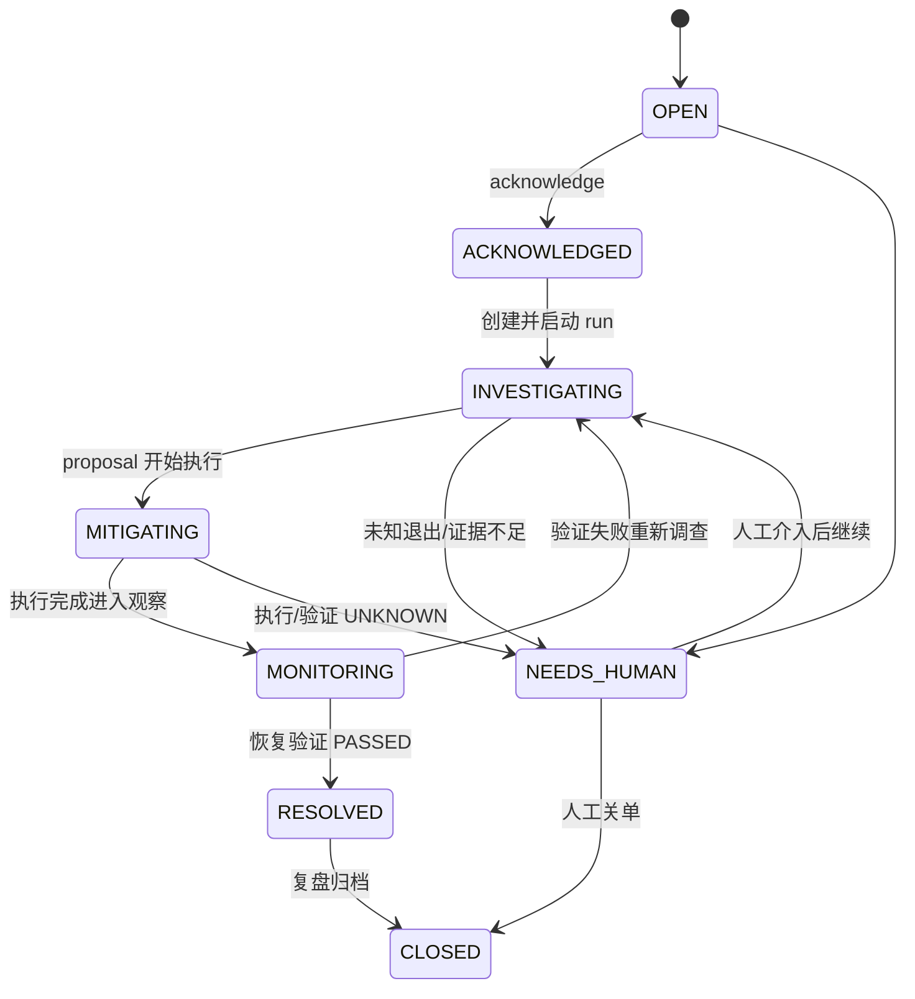
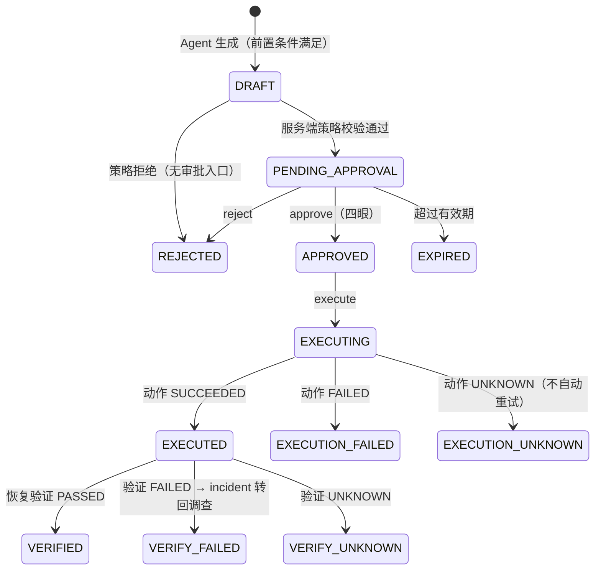

# OpsPilot Next｜接口与数据契约（D0 冻结稿）

**版本**：v1.1（D0 契约冻结；v1.1 为架构评审定向修订——幂等保证等级分级、诊断报告快照、Webhook/权限默认拒绝/事件关联修正、D1 默认决策确认）
**日期**：2026-10-27
**需求基线**：`docs/PRD.md` v1.1 §10（API 合约清单）、§5（Evidence / Capability Manifest）、§9（状态机）、§11（核心数据模型）
**性质**：契约约束文档。端点集合以 PRD §10 为准，本文补全字段与语义细节；新增字段需评审，不得删除或改名 PRD 已定义端点。

---

## 1. 通用 API 规范

### 1.1 基础约定

| 项 | 规范 |
|---|---|
| 基础路径 | `/api/v1`（URL 版本化，见 §9） |
| 协议 | HTTPS（本地 Docker Compose 为 HTTP）、JSON UTF-8 |
| 时间 | ISO8601 UTC，一律带 `Z` 后缀（如 `2026-10-27T08:00:00Z`） |
| 标识符 | 带前缀的可读 ID：`inc_`、`run_`、`ev_`、`as_`、`alr_`、`kb_`、`rb_`、`prp_`、`apv_`、`act_`、`vf_`、`usr_`（后接小写字母数字，全局唯一） |
| 认证 | `Authorization: Bearer <JWT access token>`；**D0 评审确认：JWT access token 有效期 30 分钟，首版无 Refresh Token，过期重新登录**。`POST /auth/change-password`（D0 评审新增的最小端点，PRD §10 之外）用于引导账号首次登录强制改密 |
| OpenAPI | FastAPI 自动导出 `/openapi.json`，作为契约权威机器格式 |

### 1.2 统一响应包裹（PRD §10）

所有响应：

```json
{
  "request_id": "req_9f8a...",
  "data": { },
  "error": null
}
```

失败：

```json
{
  "request_id": "req_9f8a...",
  "data": null,
  "error": {
    "code": "FORBIDDEN_ASSET_SCOPE",
    "message": "asset as_x2 belongs to production, not in your scope",
    "details": { "asset_id": "as_x2", "environment": "production" }
  }
}
```

- `request_id` 由服务端生成，贯穿日志与审计。
- `error.code` 使用稳定枚举（§1.4），`message` 面向开发者可读，`details` 可选结构化上下文。
- **敏感信息不得进入 `message` / `details`**（凭据、内部 IP、完整日志）。

### 1.3 分页、异步与幂等

- **列表分页（cursor）**：`GET ...?cursor=<opaque>&limit=50`（limit ≤ 200）。响应 `data = { "items": [...], "next_cursor": "eyA...", "has_more": true }`。cursor 由服务端签名编码（内部含排序键 created_at,id），不支持跳页。
- **异步受理**：创建 InvestigationRun 等长任务返回 `202 Accepted`，`data` 含 `run_id` 与 `status`；后续以 GET 查询为状态权威。
- **Idempotency-Key**：以下"重要 POST"必须支持请求头 `Idempotency-Key: <uuid>`（客户端生成，服务端保存 24h）：
  `POST /incidents`、`POST /incidents/{id}/investigations`、`POST /proposals/{id}/approve|reject|execute`、`POST /knowledge/{id}/publish`、`POST /evaluations/runs`。
  - **隔离维度（D0 评审确认）**：幂等键按 `(调用者 user_id, 端点, key)` 三元组隔离；不同调用者/不同端点使用相同 key 互不冲突。幂等机制不适用于未认证端点（登录、Webhook）。
  - **Webhook 不依赖 Idempotency-Key**：第三方告警源可能不提供该头；`POST /webhooks/alerts/{connector_id}` 以**可信来源签名 + 外部 `delivery_id` 去重**为幂等手段（见 §2.2），可选接受 Idempotency-Key 但不作依赖。
  - 相同 key + 相同请求体哈希 → 重放返回首次响应，附响应头 `Idempotency-Replayed: true`；
  - 相同 key + 不同请求体 → `409 IDEMPOTENCY_KEY_MISMATCH`；
  - 未带 key 调用标记为必须幂等的端点 → `400 IDEMPOTENCY_KEY_REQUIRED`。
- **SSE 与 JSON 兼容策略（D0 评审确认）**：`GET /runs/{id}/events` 的**默认响应永远是 JSON 分页**（冻结承诺，D6 不得悄悄改变默认响应类型）。D6 起增量提供 SSE：仅当客户端显式携带 `Accept: text/event-stream` 时返回 `text/event-stream` 事件流；无该头（含 `Accept: application/json`、`*/*`）一律返回 JSON。SSE 仅是 run_events 的推送通道，**状态权威始终是 GET 结果**（PRD §12）。

### 1.4 错误码枚举（首版）

| HTTP | code | 语义 |
|---|---|---|
| 400 | `VALIDATION_ERROR` | 请求参数/Schema 校验失败 |
| 400 | `IDEMPOTENCY_KEY_REQUIRED` | 该端点要求幂等键 |
| 401 | `UNAUTHENTICATED` | 未登录/令牌失效 |
| 403 | `FORBIDDEN` | 角色不允许该操作 |
| 403 | `FORBIDDEN_ASSET_SCOPE` | 资产/环境不在授权范围 |
| 403 | `APPROVAL_REQUIRED` | 操作需先审批（无绕过路径） |
| 403 | `PASSWORD_CHANGE_REQUIRED` | 引导创建的账号首次登录必须先修改密码 |
| 404 | `NOT_FOUND` | 资源不存在（含被越权访问时的统一伪装） |
| 409 | `CONFLICT_STATE` | 状态机不允许该转换 |
| 409 | `IDEMPOTENCY_KEY_MISMATCH` | 同 key 不同请求体 |
| 409 | `APPROVAL_EXPIRED` | 审批已过有效期 |
| 409 | `PROPOSAL_SNAPSHOT_MISMATCH` | 执行时复核发现参数/版本与审批快照不一致 |
| 409 | `DUPLICATE_ALERT` | 告警去重命中（webhook 返回既有 incident） |
| 422 | `BUDGET_EXHAUSTED` | run 预算耗尽被服务端强制终止 |
| 429 | `RATE_LIMITED` | 限流 |
| 501 | `NOT_IMPLEMENTED` | 已定义但所属阶段未交付 |
| 502/504 | `UPSTREAM_UNAVAILABLE` / `UPSTREAM_TIMEOUT` | 连接器目标超时/不可达 |
| 500 | `INTERNAL` | 未分类错误（不泄漏内部细节） |

---

## 2. 核心实体契约

> 字段类型记法：`str`、`int`、`bool`、`datetime(UTC)`、`JSONB`。所有实体都有 `created_at`；可变实体有 `updated_at`。以下字段为冻结基线，新增可选字段走契约评审。
>
> **枚举写法约定**：状态枚举的存储值统一为小写蛇形（如 `open`、`running`、`waiting_approval`）；PRD §9 中的大写形式（`OPEN`、`RUNNING`）指同一状态，仅为文档写法。合法值以本文与 DATA_MODEL 的 CHECK 约束为准。

### 2.1 Asset（资产）

| 字段 | 类型 | 说明 |
|---|---|---|
| id | str `as_` | |
| name | str | 展示名，组织内唯一（name + environment 唯一） |
| environment | enum | `sandbox` / `staging` / `production`（受控枚举，PRD §8） |
| asset_type | enum | `service` / `container` / `database` / `cache` / `gateway` / `host` |
| status | enum | `active` / `retired` |
| criticality | enum | `low` / `medium` / `high` |
| endpoints | JSONB | 已登记观测入口：`{health_url, metrics_ref, logs_ref}`（供连接器使用，均可空） |
| owner | str | 负责人/团队 |
| tags | JSONB | 字符串数组 |

关联：`asset_edges`（依赖图）、`asset_observability_bindings`（D3）、`asset_access_policies`（权限）、`evidence.asset_id`、`incidents.primary_asset_id`。

### 2.2 Alert（告警）

| 字段 | 类型 | 说明 |
|---|---|---|
| id | str `alr_` | |
| connector_id | str | 来源连接器实例（如 `webhook_default`） |
| external_event_id | str | 外部来源投递 ID（delivery_id）；`(connector_id, external_event_id)` 唯一 → **Webhook 幂等的主手段**，不依赖第三方提供 Idempotency-Key |
| fingerprint | str | 归一化症状指纹（资产+症状哈希），用于关联/合并 incident |
| title / severity | str / enum | severity: `low`/`medium`/`high`/`critical` |
| payload | JSONB | 原始告警体（脱敏存储） |
| status | enum | `received` → `mapped` / `ignored` |
| incident_id | str? | 去重命中时指向既有 incident |

### 2.3 Incident（业务事故）

| 字段 | 类型 | 说明 |
|---|---|---|
| id | str `inc_` | |
| title / description | str | |
| environment | enum | 同 Asset |
| primary_asset_id | str FK | 主受影响资产 |
| source | enum | `manual` / `alert` |
| alert_id | str? | 来源告警的**逻辑引用**（无物理外键；物理 FK 方向为 `alerts.incident_id → incidents`，关联经 alerts 反查，避免循环依赖） |
| fingerprint | str | 去重键（open 状态下同 asset+fingerprint 不重复建单） |
| severity | enum | `low`/`medium`/`high`/`critical` |
| status | enum | 见下方状态机 |
| created_by | str FK→users | 手工创建 = 操作者；**Webhook 自动创建 = 预置系统账号 `usr_system_alerts`**（bootstrap 创建、禁止登录、仅服务端使用；审计 actor_type=`system`） |
| resolved_at | datetime? | |

**状态机**（PRD §9）：



非法转换一律 `409 CONFLICT_STATE`。`RESOLVED` 只能由**恢复验证 PASSED** 触达——"命令成功"不是解决（PRD S9）。

### 2.4 InvestigationRun（诊断运行）

| 字段 | 类型 | 说明 |
|---|---|---|
| id | str `run_` | |
| incident_id | str FK | `incident 1:N run` |
| status | enum | `created → queued → running → completed / waiting_approval / needs_human / failed / canceled` |
| triggered_by | str FK→users | |
| model_config | JSONB | 模型名/版本、prompt 版本、RAG 开关（on/off/text-only/hybrid）——评估可复现的锚点（PRD §13） |
| budgets | JSONB | `{max_tool_calls, max_iterations, max_tokens, deadline_at}` |
| usage | JSONB | `{tool_calls_used, iterations_used, tokens_in, tokens_out}`（服务端累计） |
| authorization_snapshot | JSONB | 创建时刻操作者可见资产/环境集合，供工具范围校验 |
| langgraph_thread_id | str | = run_id（ADR-5） |
| stop_reason | enum? | `completed` / `budget_exhausted` / `no_new_evidence` / `unknown_exit` / `canceled` / `error` |
| started_at / finished_at | datetime? | |

**状态机**：`created → queued → running`；**终态 = `completed / needs_human / failed / canceled`**。`running` 可被 `POST /runs/{id}/cancel` 合作式取消（Worker 轮询取消标志 + LangGraph 中断）。`waiting_approval` 是**可恢复等待状态而非终态**（D5 起，Proposal 待审；approve 后回到 `running` 并进入执行链路）。恢复执行（D5）目标为回到 `running`，业务状态不依赖 checkpoint 推断。
内部执行保障（非对外契约字段，见 DATA_MODEL）：DB 认领携带 `lease_owner` 与单调递增 `fence_token`，Worker 所有状态回写必须校验 token，防止租约过期的旧 Worker 复活后并发写脏数据。

### 2.5 RunEvent（运行事件流）

| 字段 | 类型 | 说明 |
|---|---|---|
| id | int 自增 | 全局序号 |
| run_id | str FK | |
| seq | int | run 内单调递增，`(run_id, seq)` 唯一，SSE 重放游标 |
| type | enum | `run_started` / `node_entered` / `node_exited` / `tool_called` / `tool_returned` / `evidence_added` / `hypothesis_added` / `budget_warning` / `error` / `run_finished` |
| payload | JSONB | 脱敏后的结构化载荷 |
| created_at | datetime | |

只追加。`GET /runs/{id}/events?after_seq=` 支持增量拉取与 SSE 重放。

### 2.6 Evidence（统一证据）

统一 Schema 见 §3。数据库字段映射见 DATA_MODEL.md。要点：

- `status ∈ {ok, error, timeout, unavailable}`；**采集失败不伪装为空数据**（PRD §5）。
- `source_type = knowledge` 的证据来自历史知识检索，与实时观测 (`metric/log/trace/health/infra`) 严格区分，**不得作为当前根因的直接证据**（PRD §0.4）。
- Evidence 不可变（创建后不 UPDATE，错误更正以新 Evidence 补充）。

### 2.7 Hypothesis（根因假设）

| 字段 | 类型 | 说明 |
|---|---|---|
| id | str `hyp_` | |
| run_id | str FK | |
| rank | int | 候选排序 |
| statement | str | 假设陈述 |
| status | enum | `candidate` / `supported` / `refuted` / `insufficient_data` |
| supporting_evidence_ids | JSONB | str 数组，引用 Evidence |
| contradicting_evidence_ids | JSONB | 反证引用 |
| missing_information | JSONB | 缺失信息清单（驱动下一步取证） |
| confidence | enum | `low` / `medium` / `high`（定性，禁止伪精确概率） |

**规则**：关键结论必须携带 Evidence ID；`supported` 至少有 1 条实时证据支撑；仅凭知识检索（source_type=knowledge）不得判 `supported`（PRD §6）。

### 2.8 Capability（连接器能力，对应 connector_types / connector_instances / capability_manifests）

**命名统一（D0 评审确认）**：REST 资源名 `integrations`（PRD §10 端点）= 物理表 `connector_instances`（连接器实例实体）。`GET/POST /integrations` 等端点操作的就是 `connector_instances` 行——两个名字是同一实体的 API 视图与存储视图，不存在独立的 integrations 表。

Manifest Schema 见 §4。对外 `GET /capabilities` 返回：`capability_id`、`connector_type`、`version`、`source_types`、`read_only`（恒 true）、`input_schema`、`output_schema`、`scopes`（环境/资产类型）、`rate_limit`、`timeout_ms`、`enabled`、`compatibility`。

### 2.9 Knowledge（knowledge_documents / knowledge_versions）

| 实体 | 关键字段 |
|---|---|
| knowledge_document | id `kb_`、`doc_type ∈ {runbook, postmortem, guide}`、title、source_incident_id?、owner、tags |
| knowledge_version | id `kbv_`、document_id、version_no、**status: `draft → reviewed → published → superseded / retired`**、content、change_note、created_by、reviewed_by、published_at、valid_from/valid_until、sensitivity、applies_to（资产/环境/版本过滤）、embedding_model+model_version、source_refs |

规则（PRD §6）：发布必须经人工复核（reviewed_by ≠ created_by）；检索先做权限/资产/环境/有效性过滤，再排序；未发布的知识对 Agent 不可见。

### 2.10 Runbook（受控操作模板）

| 实体 | 关键字段 |
|---|---|
| runbook | id `rb_`、name、description、risk_level、status（`draft`/`published`/`retired`） |
| runbook_version | id `rbv_`、runbook_id、version_no、status（`draft`/`published`/`retired`）、steps（结构化动作 JSONB）、preconditions、parameters_schema、allowed_environments（仅可为 sandbox/staging）、allowlist_action_keys、risk_level、published_at |

规则：**草稿不直接变为可执行**（PRD §10）；`risk_level ∈ {r0, r1, r2, r3}`，r2/r3 首版不实现（PRD §8）；R1 版本必须在 allowlist 中逐 key 登记。

### 2.11 Proposal（处置提案）

| 字段 | 类型 | 说明 |
|---|---|---|
| id | str `prp_` | |
| run_id | str FK | 首版必填：提案只能来自诊断 run（PRD §3.6） |
| incident_id | str FK | 冗余便于查询 |
| runbook_version_id | str FK | 引用已发布版本 |
| target_asset_id / environment | str / enum | 执行目标，environment ∈ {sandbox, staging} |
| parameters | JSONB | 按参数 Schema 校验后的参数 |
| parameter_hash | str | sha256(canonical(parameters) + runbook_version_id)，供执行前复核（PRD §8） |
| risk_level | enum | 继承 runbook 版本 |
| preconditions_result | JSONB | 前置检查快照 |
| status | enum | 见下 |
| created_by / created_by_user | str / str? | Agent 标识 / 触发人 |
| expires_at | datetime | 审批有效期（来自策略配置） |

**状态机**（PRD 未定义，本契约补充，需评审确认）：



`VERIFIED` 才允许 incident 进入 `RESOLVED` 路径。

### 2.12 Approval（审批）

| 字段 | 类型 | 说明 |
|---|---|---|
| id | str `apv_` | |
| proposal_id | str FK | |
| decision | enum | `approved` / `rejected` |
| decided_by | str FK→users | **必须 ≠ proposal.created_by_user 且具有 approver 角色**（四眼原则） |
| proposal_snapshot | JSONB | 审批时刻的参数哈希、runbook 版本、目标环境；执行前重新比对（PRD §8） |
| expires_at | datetime | 审批有效期 |
| comment | str | |

审批记录只追加、不可修改（独立审批日志，PRD §8）。

### 2.13 ActionExecution（动作执行）

| 字段 | 类型 | 说明 |
|---|---|---|
| id | str `act_` | |
| proposal_id | str FK | `proposal → approval → action_execution → verification`（PRD §11） |
| action_key | str | allowlist 登记键，如 `restart_container@v1`（幂等账本主键成分） |
| idempotency_key | str | `sha256(proposal_id + parameter_hash)`，`action_idempotency` 表引用 |
| status | enum | `pending` / `pre_check_failed` / `running` / `succeeded` / `failed` / `unknown` / `skipped` |
| external_ref | str? | 外部执行证据（如容器动作返回的 job id），用于崩溃后判定"执行前后"（PRD §18） |
| started_at / finished_at | datetime? | |
| result_detail | JSONB | 脱敏执行结果 |

规则（幂等保证等级，D0 评审修正）：

- **默认保证 = 零重复提交**：重复消息命中幂等账本 → 直接返回既有结果，**不会发起第二次外部调用**（PRD §13 强门禁：重复 side-effect 次数=0）。
- **"恰好一次外部效果"是有条件声明**：仅当 allowlist 注册该动作时，其外部接口**明确支持幂等执行与状态查询**（标注 `idempotent: true`），才可对该动作声明此保证；否则系统承诺只到"零重复提交 + UNKNOWN 不重试"。
- **崩溃收敛流程**：执行前先 `INSERT ... ON CONFLICT` 抢占账本（state=`claimed`）→ 执行外部动作 → 回写结果（state=`completed`）。若在"外部动作已成功但数据库尚未更新"时崩溃：重启后按账本处理——有 `external_evidence` 且外部接口支持状态查询 → 查询收敛为 succeeded/failed；无外部证据或外部不支持查询 → 标记 `unknown`，**禁止盲目重试**，转人工（PRD §8：审批后结果可能 unknown，不可盲目重试）。

### 2.14 VerificationResult（恢复验证）

| 字段 | 类型 | 说明 |
|---|---|---|
| id | str `vf_` | |
| execution_id | str FK | |
| status | enum | `in_progress` / `passed` / `failed` / `unknown` |
| checks | JSONB | 每项健康检查 `{name, asset_id, expected, observed, pass}` |
| observation_window | JSONB | `{start, end, sample_count}`（真实健康检查 + 观察窗口，PRD §8） |
| concluded_at | datetime? | |

### 2.15 AuditEvent（审计）

| 字段 | 类型 | 说明 |
|---|---|---|
| id | int 自增 | |
| actor_type / actor_id | enum / str | `user` / `agent` / `system` / `action_service` |
| action | str | 如 `incident.create`、`tool.invoke`、`proposal.approve` |
| resource_type / resource_id | str / str | |
| environment | enum? | |
| detail | JSONB | 脱敏 |
| request_id | str | |
| created_at | datetime | |

只追加；无 UPDATE/DELETE 接口；`GET /audit-logs` 仅 Admin/Viewer(Auditor) 可查。

### 2.16 DiagnosticReport（诊断报告快照，D2；D0 评审新增）

与 InvestigationRun 关联的**结构化报告快照**，`GET /runs/{id}/report` 的返回契约以此为准，不再依赖临时动态拼接作为唯一报告来源：

| 字段 | 类型 | 说明 |
|---|---|---|
| id | str `rpt_` | |
| run_id | str FK→investigation_runs | `run 1:N report`（重新生成留版本历史） |
| version_no | int | 报告版本，`(run_id, version_no)` 唯一；GET 默认返回最新版本，支持按版本查询 |
| status | enum | `final` / `amended`（出现更高版本后旧版本即视为 amended） |
| conclusion | JSONB | `{summary, key_findings[]}`；每条 key_finding 必须携带 Evidence ID |
| hypothesis_ids | JSONB | 引用的候选根因（含支持/反证/缺失信息） |
| evidence_refs | JSONB | 报告引用的全部 Evidence ID 快照 |
| unknown_note | JSONB | 未知/证据不足说明：`{is_unknown, reason, missing_information[]}`（S7：不得强行下结论） |
| generator | JSONB | `{model, model_version, prompt_version}` 复现锚点（PRD §13） |
| generated_at | datetime | 生成时间 |

规则：报告由图 `Report` 节点在 run 进入终态前写入；终态后不可变（更正以新版本追加）；`unknown_note.is_unknown=true` 时结论区不得出现 `supported` 级根因。

---

## 3. 统一 Evidence Schema（v1，冻结）

基于 PRD §5 原文，补全字段语义。`schema_version: "1"`。

```json
{
  "schema_version": "1",
  "evidence_id": "ev_01JD...",
  "run_id": "run_01JC...",
  "asset_id": "as_01JA...",
  "environment": "staging",
  "source_type": "metric | log | trace | health | infra | knowledge",
  "collector": "prometheus.query | docker.logs | docker.inspect | redis.health | http.health_check | knowledge.search",
  "observed_at": "2026-10-27T08:00:00Z",
  "time_range": { "start": "2026-10-27T07:50:00Z", "end": "2026-10-27T08:00:00Z" },
  "status": "ok | error | timeout | unavailable",
  "data_ref": "内联截断载荷或对象键引用（存储为 evidence.data_ref JSONB 单表内联，无独立 payload 表）",
  "summary_redacted": "脱敏后的自然语言/结构化摘要（进入 Prompt 的唯一内容）",
  "correlation": { "service": "order-api", "trace_id": null },
  "error_code": null,
  "truncated": false,
  "created_at": "2026-10-27T08:00:01Z"
}
```

约束：

| 约束 | 说明 |
|---|---|
| 时间 | 必须携带采集时刻与覆盖范围；连接器时钟偏差由网关记录 `observed_at` 为服务端时间并保留目标侧时间 |
| 映射 | `asset_id` 必须命中授权快照内的资产；`correlation.service` 与资产映射由注册信息提供 |
| 失败语义 | `error/timeout/unavailable` 的 Evidence `summary_redacted` 描述失败本身；**不返回伪空数据** |
| 脱敏与上限 | 网关执行脱敏规则与长度上限（默认 summary ≤ 2KB、payload ≤ 256KB，超限 `truncated=true`） |
| 知识隔离 | `source_type=knowledge` 强制携带 `correlation.knowledge_ref`，不得与实时证据混排为同一性质 |
| 不可变 | Evidence 落库后不可更新 |

---

## 4. Connector Capability Manifest（v1，冻结）

```json
{
  "manifest_version": "1",
  "connector_id": "redis-ro",
  "connector_version": "1.2.0",
  "display_name": "Redis 只读健康检查",
  "source_types": ["health", "infra"],
  "capabilities": [
    {
      "capability_key": "check_redis_health",
      "read_only": true,
      "description": "读取 Redis PING/INFO 基线",
      "input_schema": {
        "type": "object",
        "properties": {
          "asset_id": { "type": "string" }
        },
        "required": ["asset_id"],
        "additionalProperties": false
      },
      "output_schema": { "ref": "urn:opspilot:evidence:1" }
    }
  ],
  "scopes": {
    "environments": ["sandbox", "staging", "production"],
    "asset_types": ["cache"]
  },
  "auth_ref": "secret_ref:redis-reader",
  "rate_limit": { "max_calls_per_run": 30, "per_second": 2 },
  "timeout_ms": 5000,
  "result_max_bytes": 262144,
  "health_check": { "capability_key": "check_redis_health", "interval_s": 60 },
  "compatibility": { "min_platform": "0.1.0", "tested_versions": ["1.2.0"] }
}
```

规则（PRD §5）：

- 所有 capability `read_only: true`；写能力不在本 Manifest 模型内（写 = Runbook/allowlist，由 Action Service 独立管理）。
- **Docker 连接器强制走只读 API 代理（D0 评审确认）**：只读挂载 docker.sock 不能保证 Docker API 只读（socket 持有者拥有 Daemon 完全控制权）。Docker capability 的目标端点必须是 docker-ro-proxy 的白名单端点（仅容器只读方法+路径）；Manifest 校验不满足该条件的 Docker capability 直接拒绝注册。
- 注册中心支持：校验、启用/禁用、版本与兼容检查、连通性测试（`POST /capabilities/{id}/tests`）；**不支持前端上传脚本立即执行**。
- 新连接器经过代码审查 + 隔离测试 + Admin 受控部署（仓库内代码 + 迁移，不走 API 上传）。

---

## 5. `/api/v1` 端点契约（对齐 PRD §10）

> 全部端点、方法、路径以下表为准 = PRD §10 原文；"交付"列标注首次实现的关卡（详见 IMPLEMENTATION_PLAN.md）。示例仅列关键语义，完整请求/响应以 OpenAPI 为权威。

| 模块 | 端点 | 语义要点 | 交付 |
|---|---|---|---|
| Auth | `POST /auth/login` | 用户名/密码 → `{access_token, token_type, expires_in}` | D1 |
| Auth | `GET /auth/me` | 当前用户、角色、资产范围摘要 | D1 |
| Auth | `POST /auth/change-password` | 修改自身密码；引导创建的账号首登强制调用（D0 评审新增的最小端点） | D1 |
| Assets | `GET /assets`、`POST /assets` | 列表（cursor，environment 过滤）/ 创建（Admin） | D1 |
| Assets | `PATCH /assets/{id}` | 部分更新（Admin） | D1 |
| Integrations | `GET /integrations`、`POST /integrations` | 连接器实例配置（= connector_instances，命名统一见 §2.8；secret 只存引用） | D2/D3 |
| Integrations | `POST /integrations/{id}/test`、`POST /integrations/{id}/disable` | 连通性测试 / 禁用 | D3 |
| Capabilities | `GET /capabilities`、`GET /capabilities/{id}` | 能力发现与 Schema | D3 |
| Capabilities | `POST /capabilities/{id}/tests` | 受控测试（记录 capability_test_runs） | D3 |
| Alerts | `POST /webhooks/alerts/{connector_id}` | 可信来源 HMAC-SHA256 签名 + timestamp 防重放；**以 delivery_id 去重为幂等主手段**（不依赖第三方 Idempotency-Key）；需新建 incident 时创建主体 = 系统账号 `usr_system_alerts` | D1（骨架）/D3 |
| Incidents | `POST /incidents`、`GET /incidents`、`GET /incidents/{id}` | 幂等创建；列表按状态/环境/资产过滤 | D1 |
| Incidents | `POST /incidents/{id}/acknowledge` | 状态转换 OPEN→ACKNOWLEDGED | D1 |
| Runs | `POST /incidents/{id}/investigations` | 创建 run（预算/快照/幂等），`202 {run_id}` | D2 |
| Runs | `GET /runs/{id}` | 状态+usage+stop_reason | D2 |
| Runs | `GET /runs/{id}/events` | 事件流；**默认 JSON 分页**，D6 起仅对显式 `Accept: text/event-stream` 返回 SSE（兼容策略见 §1.3） | D2 |
| Runs | `POST /runs/{id}/cancel` | 合作式取消 | D2 |
| Evidence | `GET /runs/{id}/evidence` | 证据列表（按 source_type/status 过滤） | D2 |
| Evidence | `GET /runs/{id}/report` | 诊断报告（返回 `diagnostic_reports` 最新版本快照：结论/候选根因/Evidence 引用/未知说明，见 §2.16） | D2 |
| Knowledge | `GET/POST /knowledge/documents` | 文档管理（draft 创建） | D4 |
| Knowledge | `GET /knowledge/search` | 权限过滤 + text/pgvector 混合检索，返回引用 | D4 |
| Knowledge | `POST /knowledge/{id}/publish`、`POST /knowledge/{id}/retire` | 人工复核发布/退役 | D4 |
| Runbooks | `GET/POST /runbooks`、`PATCH /runbooks/{id}`、`POST /runbooks/{id}/publish` | 草稿不直接可执行 | D4/D5 |
| Proposals | `GET /proposals/{id}` | 详情（diff、参数、风险、审批状态） | D5 |
| Proposals | `POST /proposals/{id}/dry-run` | 只读前置检查 | D5 |
| Proposals | `POST /proposals/{id}/approve`、`/reject` | 四眼审批；幂等 | D5 |
| Proposals | `POST /proposals/{id}/execute` | 校验审批/快照/有效期后入队 | D5 |
| Executions | `GET /executions/{id}` | 执行与验证状态 | D5 |
| Eval | `GET /evaluations/suites`、`POST /evaluations/runs`、`GET /evaluations/runs/{id}` | 固定数据集测评 | D6 |
| Audit | `GET /audit-logs` | 审计查询（Admin/Auditor） | D1 起（逐步丰富） |
| Health | `GET /health/live`、`GET /health/ready` | 存活/就绪（ready 检查 DB 连接） | D1 |

---

## 6. Agent Tool 契约（内部，非 REST）

工具由 Tool Gateway 按 Capability Manifest 生成，供 DeepAgents 调用。首版工具集（对齐 PRD §10）：

| 工具 | 输入 | 输出（Unified Evidence） | 交付 |
|---|---|---|---|
| `get_service_health` | `{asset_id}` | source_type=health | D2 |
| `get_container_status` | `{asset_id}` | infra（状态/事件/OOM/退出码）；**经 docker-ro-proxy 白名单只读端点** | D2 |
| `read_container_logs` | `{asset_id, time_range?, tail_limit?}` | log（脱敏截断）；经 docker-ro-proxy | D2 |
| `check_redis_health` | `{asset_id}` | health | D2 |
| `read_mysql_diagnostics` | `{asset_id}` | infra（只读状态/连接数/慢查询摘要） | D3+ |
| `query_metrics` | `{asset_id, query, time_range}` | metric | D3 |
| `query_traces` | `{asset_id, trace_id?, time_range}` | trace | D3 |
| `retrieve_incidents` | `{asset_id?, environment?, keywords?}` | knowledge（历史事故摘要+引用） | D2（元数据）/D4（RAG 增强） |
| `search_runbooks` | `{query, environment?}` | knowledge（已发布 Runbook 引用） | D4（此前返回空集并说明） |

工具通用行为：

1. 校验 manifest 启用态、参数 Schema、资产/环境命中授权快照；
2. 强制超时/限流/大小上限，失败映射为 `status=error|timeout|unavailable` 的 Evidence（含 error_code）；
3. 结果落 Evidence 库，返回给模型 `{evidence_id, status, summary_redacted, correlation, truncated}`；
4. 每次调用写 `run_events`（tool_called/tool_returned）与 `audit_events`；
5. 外部返回内容按不可信文本处理（脱敏、截断、注入模式标记）。

### Agent Tool 与 REST API 的区别

| 维度 | REST API（`/api/v1`） | Agent Tool（Tool Gateway） |
|---|---|---|
| 受众 | 前端/集成方/人 | LLM Agent（Worker 进程内） |
| 契约来源 | OpenAPI（PRD §10 清单） | Capability Manifest（§4） |
| 鉴权 | JWT + RBAC + 资产范围 | run 的授权快照 + manifest 范围白名单 |
| 操作性质 | 读 + 受控状态转换（审批/发布等） | **仅只读取证** + 知识检索 |
| 幂等 | Idempotency-Key | 只读天然幂等；证据不可变 |
| 版本 | URL `/api/v1` | manifest_version + connector_version |
| 错误语义 | HTTP 状态 + error.code | Evidence.status（error/timeout/unavailable） |
| 输出 | 完整资源视图 | Evidence 引用 + 脱敏摘要（原始数据不进 Prompt） |
| 审计 | 请求级 audit_events | 调用级 audit_events + run_events |
| 暴露面 | 网络可达 | 不可网络直达，仅存在于 Worker 进程 |

---

## 7. 权限边界

### 7.1 角色矩阵

| 操作 | Operator | Approver | Admin | Viewer/Auditor |
|---|---|---|---|---|
| 创建/确认事件、发起 run | ✓（范围内） | ✓ | ✓ | ✗ |
| 查看事件/run/证据/报告 | ✓（范围内） | ✓ | ✓ | ✓（范围内） |
| 知识草稿创建 | ✓ | ✓ | ✓ | ✗ |
| 知识发布/退役 | ✗ | ✓ | ✓ | ✗ |
| Runbook 编辑/发布 | ✗ | ✗ | ✓ | ✗ |
| Proposal dry-run / execute | ✓（范围内，执行需已批准） | ✓ | ✓ | ✗ |
| **Proposal approve / reject** | **✗（与提案人四眼分离）** | ✓ | ✓ | ✗ |
| 资产/集成/能力管理 | ✗ | ✗ | ✓ | ✗ |
| 审计查询 | ✗ | ✗ | ✓ | ✓ |

### 7.2 范围与强制点

- 权限 = 角色 × 资产/环境范围（asset_access_policies）。**默认拒绝（D0 评审确认）**：无任何匹配策略即拒绝；策略条目 `user_id` 与 `role_id` **互斥**（恰好一个非空）；授权判定 = 用户级策略 ∪ 所属角色级策略的并集；Admin 不受资产范围限制（资产管理角色）。**前端禁用按钮不是权限实现**（PRD §12）；服务端三处强制：API 层 RBAC 首道校验、Orchestrator 授权快照、Action Service 执行前复核。
- 越权查询返回 `404 NOT_FOUND`（不暴露资源存在性）。
- `approve` 与 `execute` 中：`decided_by ≠ proposal.created_by_user`；生产环境操作首版直接 `403`（只读，无审批通道）。

---

## 8. 业务状态与执行状态的归属（DB vs LangGraph）

| 状态 | 归属 | 说明 |
|---|---|---|
| Incident 状态机 | **DB（业务）** | 只有业务代码可写 |
| Run 业务状态（created/queued/running/waiting_approval（可恢复等待）/终态） | **DB（业务）** | Orchestrator 依据图生命周期事件翻译写入 |
| Run 预算与 usage 计数 | **DB（业务，服务端硬限制）** | Worker 每步检查；超限强制终止（PRD §9） |
| RunEvent 事件流 | **DB（业务）** | SSE 重放数据源；checkpoint 不承担该职责 |
| Proposal/Approval/ActionExecution/Verification | **DB（业务）** | 图中 PolicyGate/Approval/Execute 节点只是流程占位，真实决策在业务模块 |
| Evidence/Hypothesis/DiagnosticReport（快照） | **DB（业务）** | 图执行产物落库，图结束仍可查 |
| 知识生命周期 | **DB（业务）** | 与 run 解耦，人工流转 |
| 幂等账本 | **DB（业务）** | at-least-once 投递下的**零重复提交**保障；"恰好一次外部效果"仅对声明外部幂等的动作成立（§2.13） |
| 图内推进状态（当前节点、消息、待完成工具调用） | **LangGraph checkpoint（langgraph schema）** | 仅服务执行恢复与 HITL 中断；`thread_id = run_id` |
| 中断/恢复点 | **LangGraph checkpoint** | Worker 崩溃后从最近 checkpoint 恢复；**是否可恢复由 DB 业务状态裁决**（如已 canceled 则不再恢复） |

判定规则：**凡需要跨进程查询、审计、展示的状态一律进 DB；只服务"下一次执行从哪继续"的状态留给 LangGraph。** checkpoint 丢失的最坏后果是重跑一次只读诊断（受预算约束），不产生业务错误状态。

---

## 9. 接口版本策略

1. **URL 版本**：破坏性变更（删字段、改语义、改状态机）发布 `/api/v2`，`/api/v1` 保留至少一个完整里程碑；非破坏变更（新增可选字段、新端点）在 v1 内演进。
2. **Evidence / Manifest Schema 版本**：`schema_version` / `manifest_version` 字段独立演进；读取端必须兼容当前与前一个主版本。
3. **组件版本记录**：模型、prompt、embedding、RAG 索引、runbook 版本随 run/eval 快照留档（PRD §13、§16），变更后触发评估回归。
4. **连接器兼容**：manifest `compatibility.min_platform`；平台升级时对未声明兼容的连接器标记不兼容并禁用（Admin 确认后恢复）。
5. **数据库迁移**：Alembic，向后兼容或提供迁移方案（PRD §16）；禁止在业务代码中做 schema 猜测。
6. **变更流程**：新能力先 RFC（PRD §16）；本契约文件变更需在 PR 中说明对 OpenAPI/前端/评估的影响。
