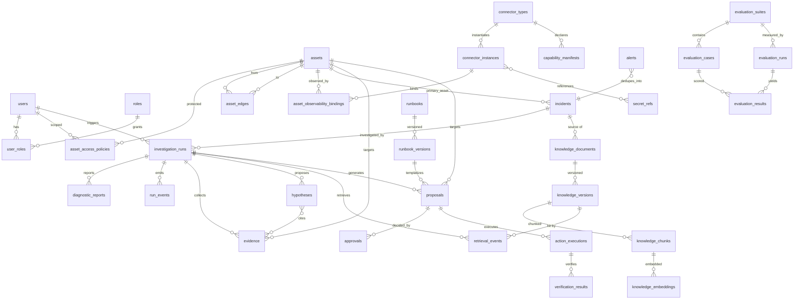

# OpsPilot Next｜数据模型（D0 冻结稿）

**版本**：v1.1（D0；含架构评审修订：诊断报告快照表、Worker fencing、幂等键隔离、系统账号、Docker 只读代理约束、权限默认拒绝）
**日期**：2026-10-27
**需求基线**：`docs/PRD.md` v1.1 §11（核心数据模型）；字段语义承接 `docs/CONTRACTS.md` §2
**性质**：建表约束文档，配合 Alembic 迁移执行；**按关卡分批建表，D1 不创建后续阶段的表。**

---

## 1. 设计原则

1. **单一 PostgreSQL 实例，schema 隔离**：业务表在 `public`；LangGraph checkpoint 在 `langgraph` schema（由 checkpointer 库自管，本文不定义其内部表）；pgvector 只作用于 `knowledge_embeddings`。
2. **业务关系用真实外键与列表达**，不用 JSONB 大字段代替可检索关系（PRD §11）。
3. **ID 形态**：对外字符串带前缀（`inc_xxx`）；数据库主键使用同值 `TEXT`（便于跨库排障），辅以 `BIGINT` 自增代理键的高频表（run_events、audit_events）用 `(run_id, seq)` 保证业务唯一。
4. **枚举落地**：状态枚举使用 PostgreSQL 原生枚举类型或 `TEXT + CHECK` 约束（实现取 `TEXT + CHECK`，迁移更灵活），合法值以 CONTRACTS.md 为准。
5. **时间一律 `TIMESTAMPTZ` UTC**。
6. **只追加不可变数据**（evidence、run_events、audit_events、approvals、diagnostic_reports）不提供 UPDATE 路径；**幂等账本例外**：`action_idempotency` 仅允许状态收敛转换（`claimed → completed / unknown`），不删除、不重写既有结果。
7. **软删除仅用于资产/知识**（`status=retired`），审计与证据永不物理删除（归档策略另定）。

---

## 2. 分阶段建表清单

| 关卡 | 新建表 | 说明 |
|---|---|---|
| **D1** | users, roles, user_roles, asset_access_policies, assets, asset_edges, alerts, incidents, audit_events, api_idempotency_keys, outbox_events | outbox 仅建表不启用（D5 启用），避免 D5 补迁移 |
| **D2** | investigation_runs, run_events, evidence, hypotheses, diagnostic_reports, connector_types, connector_instances, secret_refs + `langgraph` schema | 诊断纵切全量数据族（integrations 为 connector_instances 的 REST 视图，非独立表） |
| **D3** | capability_manifests, capability_test_runs, asset_observability_bindings | 声明式连接器与观测绑定 |
| **D4** | knowledge_documents, knowledge_versions, knowledge_chunks, knowledge_embeddings, retrieval_events, runbooks, runbook_versions | 启用 pgvector 扩展 |
| **D5** | proposals, approvals, action_executions, action_idempotency, verification_results | outbox_events 开始消费；rabbitmq 引入（无新表） |
| **D6** | evaluation_suites, evaluation_cases, evaluation_runs, evaluation_results | 评估数据族 |

`alembic_version` 随迁移自动存在。

---

## 3. 表定义

### 3.1 用户与权限（D1）

**users**

| 列 | 类型 | 约束/索引 |
|---|---|---|
| id | TEXT PK | `usr_` 前缀 |
| username | TEXT | UNIQUE NOT NULL |
| email | TEXT | UNIQUE NOT NULL |
| password_hash | TEXT | NOT NULL（argon2/bcrypt，禁明文） |
| display_name | TEXT | |
| is_active | BOOLEAN | DEFAULT true |
| must_change_password | BOOLEAN | DEFAULT false；bootstrap 创建的账号置 true，首登强制改密（D0 评审确认） |
| created_at / updated_at | TIMESTAMPTZ | |

**roles**：`id TEXT PK`，`code TEXT UNIQUE`（`operator/approver/admin/viewer`），`name TEXT`。
**user_roles**：`user_id FK→users`，`role_id FK→roles`，PRIMARY KEY(user_id, role_id)。

**asset_access_policies**

| 列 | 类型 | 约束/索引 |
|---|---|---|
| id | TEXT PK | `pol_` |
| user_id | TEXT FK→users, NULL | 与 role_id **互斥**：CHECK((user_id IS NOT NULL)::int + (role_id IS NOT NULL)::int = 1) |
| role_id | TEXT FK→roles, NULL | |
| asset_id | TEXT FK→assets, NULL | 与 environment 组合表达范围；均为空 = 全部 |
| environment | TEXT CHECK(sandbox/staging/production), NULL | |
| permission | TEXT CHECK(in `read/investigate/approve/execute`) | |
| created_at | TIMESTAMPTZ | |

索引：`(user_id)`、`(role_id)`、`(asset_id)`。

**判定规则（D0 评审确认）**：**默认拒绝**——无匹配策略即拒绝，不存在"空策略 = 全开放"语义；授权 = 用户级策略 ∪ 所属角色级策略的并集；Admin 不受资产范围限制（资产管理角色）。

### 3.2 资产与拓扑（D1）

**assets**

| 列 | 类型 | 约束/索引 |
|---|---|---|
| id | TEXT PK | `as_` |
| name | TEXT NOT NULL | UNIQUE(name, environment) |
| environment | TEXT NOT NULL CHECK(sandbox/staging/production) | INDEX(environment, status) |
| asset_type | TEXT CHECK(service/container/database/cache/gateway/host) | |
| status | TEXT CHECK(active/retired) | |
| criticality | TEXT CHECK(low/medium/high) | |
| endpoints | JSONB | `{health_url, metrics_ref, logs_ref}`，可空 |
| owner | TEXT | |
| tags | JSONB | string[] |
| created_at / updated_at | TIMESTAMPTZ | |

**asset_edges**：`id TEXT PK`、`from_asset_id FK`、`to_asset_id FK`、`relation CHECK(depends_on/runs_on/serves)`、`created_at`；UNIQUE(from_asset_id, to_asset_id, relation)；INDEX(to_asset_id)。约束 CHECK(from_asset_id <> to_asset_id)。

### 3.3 告警与事件（D1）

**alerts**

| 列 | 类型 | 约束/索引 |
|---|---|---|
| id | TEXT PK | `alr_` |
| connector_id | TEXT NOT NULL | UNIQUE(connector_id, external_event_id) → 去重 |
| external_event_id | TEXT NOT NULL | |
| fingerprint | TEXT NOT NULL | INDEX |
| title / severity | TEXT / TEXT CHECK(low/medium/high/critical) | |
| payload | JSONB | 脱敏后原文 |
| status | TEXT CHECK(received/mapped/ignored) | |
| incident_id | TEXT FK→incidents, NULL | INDEX；**唯一物理外键方向 alerts→incidents** |
| received_at | TIMESTAMPTZ | INDEX |

**incidents**

| 列 | 类型 | 约束/索引 |
|---|---|---|
| id | TEXT PK | `inc_` |
| title / description | TEXT NOT NULL / TEXT | |
| environment | TEXT NOT NULL CHECK(...) | INDEX(environment, status) |
| primary_asset_id | TEXT FK→assets NOT NULL | INDEX(primary_asset_id, status) |
| source | TEXT CHECK(manual/alert) | |
| alert_id | TEXT, NULL | 逻辑引用告警（**不加物理外键**，避免与 alerts.incident_id 循环依赖；关联经 alerts.incident_id 反查） |
| fingerprint | TEXT | 局部唯一：UNIQUE(primary_asset_id, fingerprint) WHERE status IN ('open','acknowledged','investigating','mitigating','monitoring')（活跃单去重） |
| severity | TEXT CHECK(low/medium/high/critical) | |
| status | TEXT CHECK(open/acknowledged/investigating/mitigating/monitoring/resolved/closed/needs_human) | |
| created_by | TEXT FK→users | 手工 = 操作者；**Webhook 自动创建 = 系统账号 `usr_system_alerts`**（bootstrap 预置、禁止登录、仅供服务端关联） |
| resolved_at | TIMESTAMPTZ, NULL | |
| created_at / updated_at | TIMESTAMPTZ | INDEX(created_at DESC) |

**告警→事件创建顺序（D0 评审确认）**：同一事务内 ① INSERT alerts(status=received) → ② 去重判定（`(connector_id, external_event_id)` 唯一约束兜底）→ ③ 需要新单时 INSERT incidents（创建主体 = 系统账号，source=alert，alert_id 指向该告警）→ ④ UPDATE alerts SET incident_id=..., status=mapped。任一步失败整体回滚，不留孤儿告警或无源事件。

### 3.4 诊断运行（D2）

**investigation_runs**

| 列 | 类型 | 约束/索引 |
|---|---|---|
| id | TEXT PK | `run_`（= langgraph thread_id） |
| incident_id | TEXT FK→incidents NOT NULL | INDEX(incident_id, created_at DESC) |
| status | TEXT CHECK(created/queued/running/completed/waiting_approval/needs_human/failed/canceled) | INDEX(status, created_at)（Worker 认领扫描）；`waiting_approval` 为**可恢复等待态，非终态** |
| triggered_by | TEXT FK→users | |
| model_config | JSONB NOT NULL | 模型/prompt/RAG 开关快照 |
| budgets | JSONB NOT NULL | `{max_tool_calls, max_iterations, max_tokens, deadline_at}` |
| usage | JSONB DEFAULT '{}' | 累计用量 |
| authorization_snapshot | JSONB NOT NULL | 授权范围快照 |
| langgraph_thread_id | TEXT NOT NULL | UNIQUE（= id，显式列便于审计追溯） |
| stop_reason | TEXT, NULL | CHECK(completed/budget_exhausted/no_new_evidence/unknown_exit/canceled/error) |
| claim_expires_at | TIMESTAMPTZ, NULL | 认领租约（D2–D4 DB 认领用，租约过期由回收任务重置为 queued） |
| lease_owner | TEXT, NULL | 认领者标识（worker 实例 ID）；状态回写时校验归属 |
| fence_token | BIGINT, NULL | 单调递增 fencing token；每次认领 +1，Worker 回写状态必须携带并比对，防止旧 Worker 租约过期复活后并发写脏数据（ADR-12） |
| started_at / finished_at | TIMESTAMPTZ, NULL | |
| created_at / updated_at | TIMESTAMPTZ | |

**run_events**

| 列 | 类型 | 约束/索引 |
|---|---|---|
| id | BIGINT GENERATED ALWAYS AS IDENTITY PK | |
| run_id | TEXT FK→investigation_runs NOT NULL | UNIQUE(run_id, seq)；INDEX(run_id, id) |
| seq | INT NOT NULL | run 内单调 |
| type | TEXT CHECK(run_started/node_entered/node_exited/tool_called/tool_returned/evidence_added/hypothesis_added/budget_warning/error/run_finished) | |
| payload | JSONB | |
| created_at | TIMESTAMPTZ | |

**evidence**（统一 Evidence，CONTRACTS §3）

| 列 | 类型 | 约束/索引 |
|---|---|---|
| id | TEXT PK | `ev_` |
| run_id | TEXT FK→investigation_runs | INDEX(run_id, source_type) |
| asset_id | TEXT FK→assets, NULL | INDEX(asset_id, observed_at DESC) |
| environment | TEXT NOT NULL | |
| source_type | TEXT CHECK(metric/log/trace/health/infra/knowledge) | |
| collector | TEXT NOT NULL | |
| observed_at | TIMESTAMPTZ NOT NULL | |
| time_range | JSONB | `{start,end}` |
| status | TEXT CHECK(ok/error/timeout/unavailable) | |
| data_ref | JSONB | 截断后的结构化载荷或对象键引用（= CONTRACTS §3 的 data_ref） |
| summary_redacted | TEXT NOT NULL | 进 Prompt 的唯一内容 |
| correlation | JSONB | `{service, trace_id, knowledge_ref?}` |
| error_code | TEXT, NULL | |
| truncated | BOOLEAN DEFAULT false | |
| schema_version | TEXT NOT NULL DEFAULT '1' | |
| created_at | TIMESTAMPTZ | |

**hypotheses**

| 列 | 类型 | 约束/索引 |
|---|---|---|
| id | TEXT PK | `hyp_` |
| run_id | TEXT FK→investigation_runs NOT NULL | INDEX(run_id, rank) |
| rank | INT | |
| statement | TEXT NOT NULL | |
| status | TEXT CHECK(candidate/supported/refuted/insufficient_data) | |
| supporting_evidence_ids | JSONB（text[]） | 应用层校验引用存在性 + source_type≠knowledge 才可支撑 |
| contradicting_evidence_ids | JSONB（text[]） | |
| missing_information | JSONB | |
| confidence | TEXT CHECK(low/medium/high) | |
| created_at | TIMESTAMPTZ | |

**diagnostic_reports**（D2，D0 评审新增：诊断报告持久化快照，字段语义见 CONTRACTS §2.16）：`id TEXT PK`（`rpt_`）、`run_id FK→investigation_runs`、`version_no INT`（UNIQUE(run_id, version_no)）、`status CHECK(final/amended)`、`conclusion JSONB`（`{summary, key_findings[]}`，每条 key_finding 带 Evidence ID）、`hypothesis_ids JSONB`、`evidence_refs JSONB`、`unknown_note JSONB`（`{is_unknown, reason, missing_information[]}`）、`generator JSONB`（model/prompt 版本）、`generated_at`、`created_at`；INDEX(run_id)。`GET /runs/{id}/report` 返回最新版本快照，**不再以动态拼接为唯一报告来源**。

### 3.5 连接器（D2 最小 / D3 完整）

**connector_types**（D2）：`id TEXT PK`（`ct_`）、`code TEXT UNIQUE`（如 `redis-ro`）、`display_name`、`read_only BOOLEAN DEFAULT true`、`created_at`。
**connector_instances**（D2）：`id TEXT PK`（`integ_`）、`connector_type_id FK`、`name`、`config JSONB`（非敏感配置；**Docker 实例的 endpoint 必须指向 docker-ro-proxy 白名单端点**，注册校验强制）、`secret_ref_ids JSONB`（引用 secret_refs）、`status CHECK(enabled/disabled)`、`enabled_at/disabled_at`；UNIQUE(name)。**REST 资源名 `/integrations` 即本表**（API 视图 = 存储实体，无独立 integrations 表，D0 评审统一命名）。
**secret_refs**（D2）：`id TEXT PK`、`alias TEXT UNIQUE`、`provider CHECK(env/compose_secret)`、`ref TEXT`（环境变量名，**不存密文**）、`created_by`、`created_at`。
**capability_manifests**（D3）：`id TEXT PK`、`connector_type_id FK`、`manifest JSONB NOT NULL`（CONTRACTS §4 全文）、`manifest_version TEXT`、`compatibility JSONB`、`created_at`；INDEX(connector_type_id)。
**capability_test_runs**（D3）：`id TEXT PK`、`manifest_id FK`、`triggered_by FK→users`、`result CHECK(passed/failed)`、`detail JSONB`、`created_at`。
**asset_observability_bindings**（D3）：`id TEXT PK`、`asset_id FK`、`instance_id FK→connector_instances`、`binding_kind CHECK(metrics/logs/traces/health)`、`config JSONB`、UNIQUE(asset_id, binding_kind)。

### 3.6 知识与 RAG（D4，启用 pgvector）

**knowledge_documents**：`id TEXT PK`（`kb_`）、`doc_type CHECK(runbook/postmortem/guide)`、`title TEXT`、`source_incident_id FK→incidents NULL`、`owner FK→users`、`tags JSONB`、`created_at/updated_at`；INDEX(doc_type)。

**knowledge_versions**

| 列 | 类型 | 约束/索引 |
|---|---|---|
| id | TEXT PK | `kbv_` |
| document_id | TEXT FK→knowledge_documents | UNIQUE(document_id, version_no)；INDEX(document_id, status) |
| version_no | INT | |
| status | TEXT CHECK(draft/reviewed/published/superseded/retired) | |
| content | TEXT | |
| change_note | TEXT | |
| created_by / reviewed_by | FK→users / FK→users NULL | |
| published_at / valid_from / valid_until | TIMESTAMPTZ NULL | |
| sensitivity | TEXT CHECK(internal/restricted) | |
| applies_to | JSONB | `{asset_ids[], environments[], asset_tags[], service_versions[]}`；**检索权限过滤必须下沉到 asset_id 粒度**（依据 run 授权快照中的具体资产集合），不得仅按 environment/通用标签放行（D0 评审修正） |
| embedding_model / embedding_model_version | TEXT / TEXT | 检索兼容判定 |
| created_at | TIMESTAMPTZ | |

**knowledge_chunks**：`id TEXT PK`、`version_id FK`、`chunk_index INT`、`content TEXT`、`token_count INT`；UNIQUE(version_id, chunk_index)。

**knowledge_embeddings**：`chunk_id FK→knowledge_chunks`、`model TEXT`、`model_version TEXT`、`vector VECTOR(1536)`（维度随模型定，迁移时固化）、`created_at`；PRIMARY KEY(chunk_id, model_version)；HNSW 索引（vector_cosine_ops）。**换 embedding 模型 = 新增行 + 检索过滤 model_version，不覆盖旧向量**（可回滚，PRD §6）。

**retrieval_events**：`id BIGINT IDENTITY PK`、`run_id FK NULL`、`query TEXT`、`filters JSONB`、`result_version_ids JSONB`、`ranks JSONB`、`used_by_agent BOOLEAN`、`latency_ms INT`、`created_at`。服务于 RAG 消融评估（PRD §6/§13）。

**runbooks / runbook_versions**：结构同 CONTRACTS §2.10——
`runbooks(id rb_, name UNIQUE, description, risk_level, status draft/published/retired, created_at/updated_at)`；
`runbook_versions(id rbv_, runbook_id FK, version_no, status draft/published/retired, steps JSONB, preconditions JSONB, parameters_schema JSONB, allowed_environments JSONB, allowlist_action_keys JSONB, risk_level, created_by, published_at, created_at; UNIQUE(runbook_id, version_no))`。
约束：`allowed_environments` 不得包含 `production`（CHECK 用应用层校验 + 迁移断言，因 JSONB 数组无法简单 CHECK）。

### 3.7 处置与执行（D5）

**proposals**

| 列 | 类型 | 约束/索引 |
|---|---|---|
| id | TEXT PK | `prp_` |
| run_id | TEXT FK→investigation_runs NOT NULL | INDEX |
| incident_id | TEXT FK→incidents NOT NULL | INDEX(incident_id) |
| runbook_version_id | TEXT FK→runbook_versions NOT NULL | |
| target_asset_id | TEXT FK→assets NOT NULL | |
| environment | TEXT CHECK(sandbox/staging) NOT NULL | **硬排除 production** |
| parameters / parameter_hash | JSONB / TEXT NOT NULL | |
| risk_level | TEXT CHECK(r0/r1) NOT NULL | r2/r3 首版不存在 |
| preconditions_result | JSONB | |
| status | TEXT CHECK(draft/pending_approval/approved/rejected/expired/executing/executed/execution_failed/execution_unknown/verified/verify_failed/verify_unknown/canceled) | INDEX(status) |
| created_by / created_by_user | TEXT / TEXT FK→users NULL | |
| expires_at | TIMESTAMPTZ | 审批有效期 |
| created_at / updated_at | TIMESTAMPTZ | |

**approvals**：`id apv_ PK`、`proposal_id FK`、`decision CHECK(approved/rejected)`、`decided_by FK→users`、`proposal_snapshot JSONB NOT NULL`、`expires_at TIMESTAMPTZ`、`comment`、`decided_at`；只追加；INDEX(proposal_id)。

**action_executions**：`id act_ PK`、`proposal_id FK`、`action_key TEXT`（allowlist 键）、`idempotency_key TEXT`（= sha256(proposal_id+parameter_hash)）、`status CHECK(pending/pre_check_failed/running/succeeded/failed/unknown/skipped)`、`executor TEXT`（action service 实例标识）、`external_ref TEXT NULL`、`result_detail JSONB`、`started_at/finished_at`、`created_at`；INDEX(proposal_id)、INDEX(status)。

**action_idempotency**（幂等账本）：`idempotency_key TEXT PK`、`action_execution_id FK`、`state CHECK(claimed/completed/unknown)`、`external_evidence JSONB`（外部执行证据，如 external_ref）、`claimed_at/completed_at`。执行前 `INSERT ... ON CONFLICT DO NOTHING` 抢占（claimed）→ 执行外部动作 → 回写 completed。**崩溃收敛**：外部动作成功但 DB 未更新时崩溃 → 有 `external_evidence` 且外部接口支持状态查询则查询收敛；否则置 `unknown`，**默认禁止对结果未知的有副作用操作盲目重试**（转人工）。"恰好一次外部效果"仅当 allowlist 动作声明外部接口支持幂等执行与状态查询（`idempotent: true`）时成立；**默认保证为零重复提交**（PRD §8/§13）。

**verification_results**：`id vf_ PK`、`execution_id FK→action_executions`、`status CHECK(in_progress/passed/failed/unknown)`、`checks JSONB`、`observation_window JSONB`、`concluded_at NULL`、`created_at`；INDEX(execution_id)。

### 3.8 异步基础设施（D1 建表 / D5 启用）

**api_idempotency_keys**：`key TEXT`、`endpoint TEXT`、`request_hash TEXT`、`user_id FK NOT NULL`、`response_status INT NULL`、`response_body JSONB NULL`、`state CHECK(received/completed)`、`created_at`、`expires_at`（默认 24h）；**PK(user_id, endpoint, key)**（按调用者+端点+键隔离，D0 评审确认）；INDEX(expires_at)（清理任务）。保留期等由配置管理（默认值见 IMPLEMENTATION_PLAN §4#10）。

**outbox_events**：`id BIGINT IDENTITY PK`、`aggregate_type TEXT`（run/proposal/...）、`aggregate_id TEXT`、`event_type TEXT`、`payload JSONB`、`status CHECK(pending/dispatched/failed)`、`attempts INT DEFAULT 0`、`next_attempt_at TIMESTAMPTZ`、`created_at/dispatched_at NULL`；INDEX(status, next_attempt_at)。与业务事务同库同事务写入（Outbox 模式），D5 起由 dispatcher 推送 RabbitMQ。

### 3.9 评估（D6）

**evaluation_suites**：`id eval_ PK`、`name UNIQUE`、`description`、`kind CHECK(fault/security/rag_ablation/reliability)`、`created_at`。
**evaluation_cases**：`id TEXT PK`、`suite_id FK`、`case_key UNIQUE`（如 `S1-redis-unreachable`）、`scenario JSONB`（注入步骤/期望类型）、`expected JSONB`（可判定期望：根因类别/应拒绝/应未知退出）、`holdout BOOLEAN`（保留测试集，PRD §13）、`created_at`。
**evaluation_runs**：`id erun_ PK`、`suite_id FK`、`config JSONB`（模型/prompt/RAG 开关/代码提交/随机种子，PRD §13）、`status CHECK(pending/running/completed/failed)`、`started_at/finished_at`、`created_at`。
**evaluation_results**：`id BIGINT IDENTITY PK`、`evaluation_run_id FK`、`case_id FK`、`incident_id FK NULL`（回放产生）、`metrics JSONB`（top1/top3/引用有效率/工具次数/token/延迟…）、`passed BOOLEAN`、`detail JSONB`；UNIQUE(evaluation_run_id, case_id)。

---

## 4. 实体关系图

---

## 5. 迁移与治理

1. **工具**：Alembic；每关卡一个迁移批次，禁止一次性生成全量 DDL。
2. **兼容性**：只加列不删列；改列需双写或视图过渡（PRD §16"向后兼容或有迁移方案"）。
3. **枚举演进**：状态枚举新增值 = 新迁移（CHECK 约束重建），并在 CONTRACTS.md 同步登记。
4. **pgvector**：D4 迁移内 `CREATE EXTENSION IF NOT EXISTS vector`；维度变更需新 embedding 表代（主键含 model_version 已预留）。
5. **归档/保留**（PRD §8）：`langgraph.checkpoints` 按 run 终态保留 N 天（默认 30，配置化）定期清理；`api_idempotency_keys` 过期清理；evidence/审计不删除只归档。清理任务随 D2 Worker 上线。
6. **数据量预估（首版）**：单组织 sandbox/staging，run 级千次量级；无分区需求，`created_at` 索引 + 归档即可，不提前分区。
